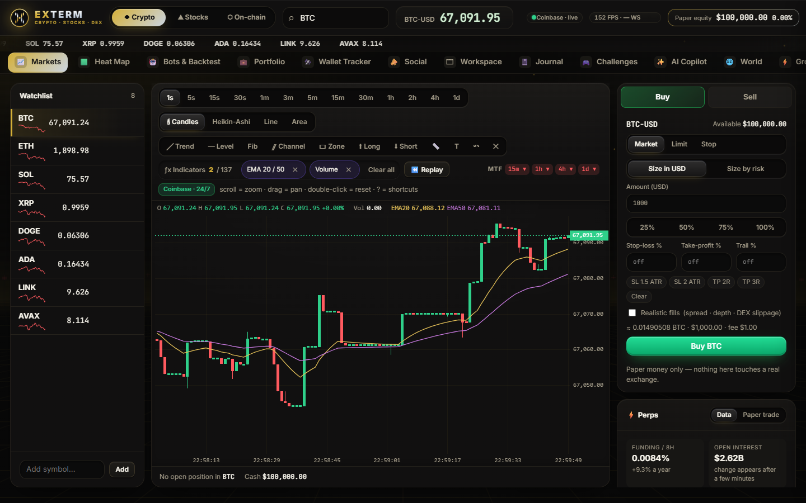
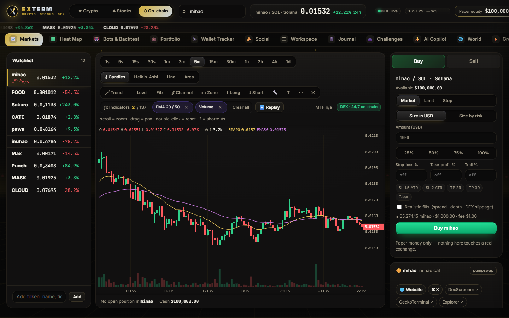
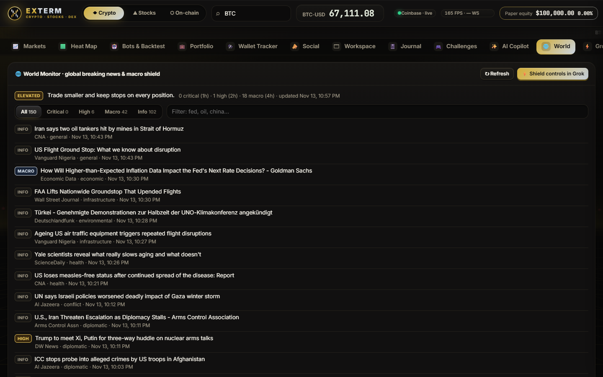
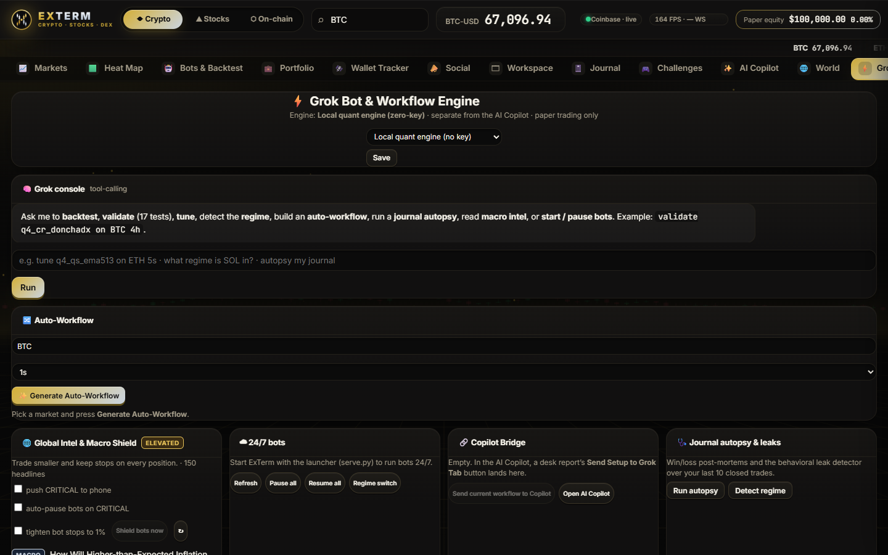

<div align="center">

# ExTerm v15.1

### Local-first trading workstation for US stocks, crypto spot & perps and on-chain DEX tokens, in one browser tab.

**Paper trading only.** Nothing in ExTerm signs or sends a real order.



**[Quickstart](#-2-second-quickstart)** · **[Features](#-whats-in-v151)** · **[Security](#-security)** · **[Verify a build](#-how-to-verify-official-builds)** · **[License](#-license)** · **[Brand policy](#-brand--logo-policy)**

<p>
  <a href="https://github.com/uexxx/ExTerm/releases/latest"></a>
  
  
  
  
</p>
<p>
  <a href="https://www.instagram.com/exterm.labs"></a>
  <a href="https://x.com/ExTermLabs"></a>
</p>

</div>

---

## ⚡ 2-Second Quickstart

ExTerm is one HTML file plus a small standard-library launcher. No account, no install step, no build step.

**Windows** — unzip to e.g. `C:\ExTerm`, then double-click **`start-exterm.bat`**
(it falls back to the built-in PowerShell server, `serve.ps1`, if Python isn't installed).

**macOS / Linux**

```bash
cd ~/ExTerm
./start-exterm.sh        # macOS: double-click start-exterm.command
# or directly:
python3 serve.py         # http://localhost:8765, opens Chrome
```

Useful flags: `python3 serve.py 9000` (other port) · `--no-browser` · `--doctor` (health check, add `--offline` to skip network checks).

> Opening `exterm.html` directly also works for crypto, but browsers block some stock and on-chain sources. The launcher
> proxies only an allow-list of public market-data hosts, on `localhost`, behind a fresh per-launch token.

---

## ✨ What's in v15.1

### 🔁 1-Click Universal Market Swap


Switch between **Crypto** (Coinbase, Kraken, Binance spot plus a paper **perps** ticket), **Stocks** (US equities and ETFs
via Yahoo Finance) and **On-chain** (Solana DEX pools via DexScreener and GeckoTerminal) from the header. Each mode keeps
its own watchlist, selected symbol and timeframe, and the same chart, ticket, indicators and tools follow you across.



Charts draw at your display's refresh rate (an adaptive governor targets 60 – 240 Hz and steps down when frames get expensive).
One-click **workspace presets** (Alt+1…4): Scalper, Solana Trench, Quant Lab, Macro War Room.

### 🕯 Live 1s & 5s candles

1s / 5s / 15s / 30s charts are built from every trade print (Binance `@trade`, Coinbase `matches`, Kraken `trade`), so highs
and lows move inside each second. Stock and DEX bars use each launcher quote (about one every 2 s); ExTerm never invents wicks
that didn't trade. Sub-minute charts scale to the candles on screen, with a 3 px minimum body.

### 🎯 Chart + click-to-trade, draggable SL/TP, % risk sizing

- A **+** handle on the price axis places a paper limit / stop order, alert or level at that exact price.
- Buys open a **draft bracket** with draggable **Entry**, **Stop-Loss** and **Take-Profit** lines, shaded risk/reward zones,
  live $ P&L and R-multiple. Breakeven, Partial TP 50 %, and Ctrl+Z / Ctrl+Y for line moves.
- A **% risk pill** sizes the position from your account risk and stop distance, with **Apply Size**.
- Optional **realistic fills**: spread, order-book depth impact, DEX AMM fee and slippage.

### 📊 137 indicators · 128 backtestable strategies

- **137 indicators** in a searchable picker, with editable settings and multi-timeframe trend chips.
- **128 backtestable strategies** (SMC, trend, momentum, mean reversion, breakout, volume, price action, on-chain, plus
  crypto / stocks / DEX / quant packs) and a no-code strategy builder.
- **17-test Validation Lab** that grades a strategy A–F, **walk-forward optimisation** (in-sample parameter pick,
  out-of-sample score), **Monte Carlo** (1,000 seeded trade reshuffles), risk of ruin and a candle data-quality grade.
- **Pine Script v5**: export strategies to Pine Script v5, and a **v5-compatible importer** that translates a safe subset
  (`ta.*` indicators, crossovers, comparisons, `strategy.entry` / `close`, % stops) into ExTerm's no-code format. It never
  executes the script and lists anything it skipped.

### ⚡ Dedicated Grok & World tabs



- **World** — the World Monitor feed: global breaking and macro headlines with severity counts and filters, and the live
  **Macro Shield** level. Every headline is escaped; links are limited to http(s).
- **Grok** — a tool-calling bot & workflow console: backtest, run the Validation Lab, tune, detect the regime, build an
  auto-workflow, run a journal autopsy, read macro intel and start / pause launcher bots. Works with a local quant engine
  (no key) or your own xAI key.



### 🏆 Prop-firm & Black Swan challenges

- **Prop-Firm $50K / $100K Evaluation**: +8 % target, 4 % daily loss limit, 8 % max trailing drawdown.
- **Black Swan Survival**: 2020 COVID, 2022 FTX and 2008 financial-crisis scenarios.
- Also: 10-min scalping sprint, zero-indicator price action, and a strategy → prop-challenge runner for any backtestable strategy.
- Every round earns a discipline grade (A+ to F) and an optional 1080×1080 flex card.

### 🔐 AES-256 local vault + SHA-256 CSP

- API keys and alert channels live in a **local vault**: AES-256-GCM with a PBKDF2-SHA256 key (600,000 rounds) from your passphrase.
  By default keys last for the browser session only and are never written to disk in plain text.
- **Encrypted `.exterm` backups** of everything ExTerm stores (AES-256-GCM, PBKDF2-SHA256, 600,000 rounds).
- See [Security](#-security) for the CSP and launcher hardening.

---

## 🛡 Security

- **Strict Content-Security-Policy**: `default-src 'none'`, and the single bundled script is pinned by its **SHA-256 hash**
  at build time. Injected `<script>`, inline event handlers (`onclick`, `onchange`, …) and `eval` are blocked; the source
  contains no inline handlers.
- **Escaped rendering**: all remote data (token names, news, social posts, wallet data) is HTML-escaped; links must be
  absolute `http(s)`.
- **Launcher lock-down** (`serve.py`, `serve.ps1`): listens on localhost only, fresh session token every launch, exact
  Origin + port check, Host allow-list against DNS rebinding, rate limiting, proxy allow-list with redirect re-validation
  and response size caps.
- Audit report: [`SECURITY-AUDIT.md`](SECURITY-AUDIT.md) · reporting policy: [`SECURITY.md`](SECURITY.md).

---

## ✅ How to verify official builds

Official releases are published only at **<https://github.com/uexxx/ExTerm/releases>**. Each ships a `SHA256SUMS.txt`
with relative file names.

```bash
# macOS / Linux, from the ExTerm folder
sha256sum -c SHA256SUMS.txt          # macOS: shasum -a 256 -c SHA256SUMS.txt
```

```powershell
# Windows PowerShell, from the ExTerm folder
Get-Content SHA256SUMS.txt | ForEach-Object {
  $h, $f = $_ -split '\s+', 2
  if ((Get-FileHash $f -Algorithm SHA256).Hash -eq $h) { "OK   $f" } else { "FAIL $f" }
}
```

`python3 serve.py --doctor` also checks the app file against its checksum. `dist/SHA256SUMS.txt` covers every file in `dist/`.

---

## 🔧 Build from source

```bash
python3 build.py             # dist/exterm.html (readable) + exterm.html
python3 build.py --harden    # dist/exterm.min.html (minified with esbuild)
```

`build.py` inlines `src/*.js` and `src/style.css` into one file and stamps the CSP with the bundle's SHA-256 hash.
Tests: `powershell -ExecutionPolicy Bypass -File test\run-all.ps1` (unit, launcher and browser end-to-end suites;
needs Node 18+, Playwright and Chrome).

---

## 📜 License

ExTerm's source code is licensed under the **[GNU Affero General Public License v3.0](LICENSE)**. You may run, inspect
and modify it under the terms of that license. If you distribute a modified version, or let people use one over a network
(for example a hosted web wrapper), you must release its complete source under AGPL-3.0 and keep the copyright and
license notices. The ExTerm name and logo are **not** licensed; see the brand policy below.

Copyright (c) 2026 ExTerm Labs (@exterm.labs) · Licensed under GNU AGPL-3.0 · https://github.com/uexxx/ExTerm

## 🏷 Brand & Logo Policy

The names **ExTerm**, **ExTerm.labs**, **@exterm.labs** and the **Candle X** candlestick-and-diamond mark are reserved and
are not covered by the AGPL. Forks must use their own name and logo and credit <https://github.com/uexxx/ExTerm>.
Details: **[`BRAND_GUIDELINES.md`](BRAND_GUIDELINES.md)**.

## 📣 Follow ExTerm Labs

- **Instagram:** [@exterm.labs](https://www.instagram.com/exterm.labs): demos, new features and release drops
- **X (Twitter):** [@ExTermLabs](https://x.com/ExTermLabs): updates and changelogs

Official accounts are only the ones above and <https://github.com/uexxx/ExTerm>.

---

<sub>ExTerm is an educational paper-trading tool, not financial advice. Market data comes from third-party public APIs and may
be delayed or wrong. Past backtest results do not predict future returns.</sub>
