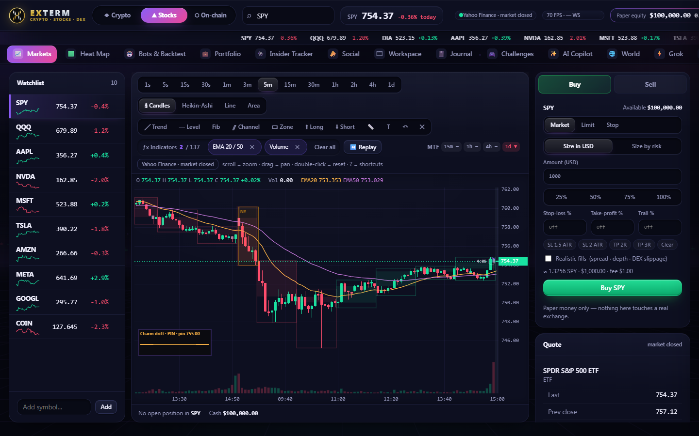
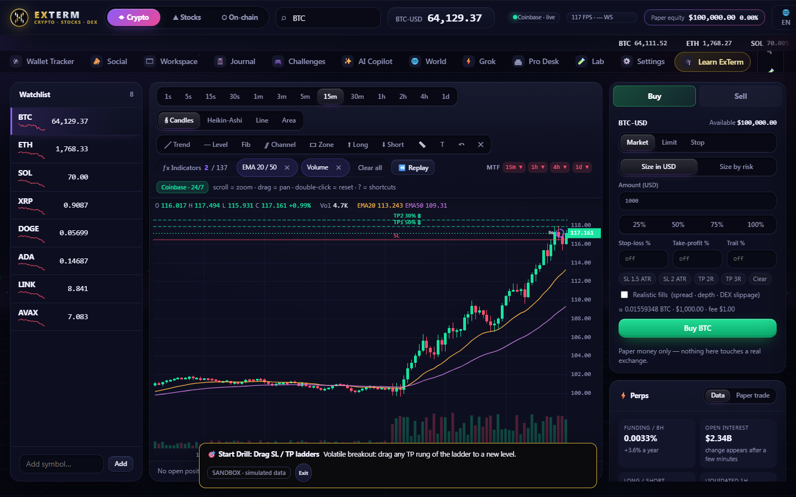
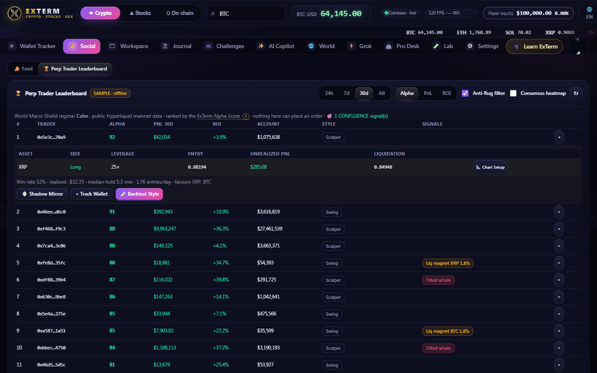
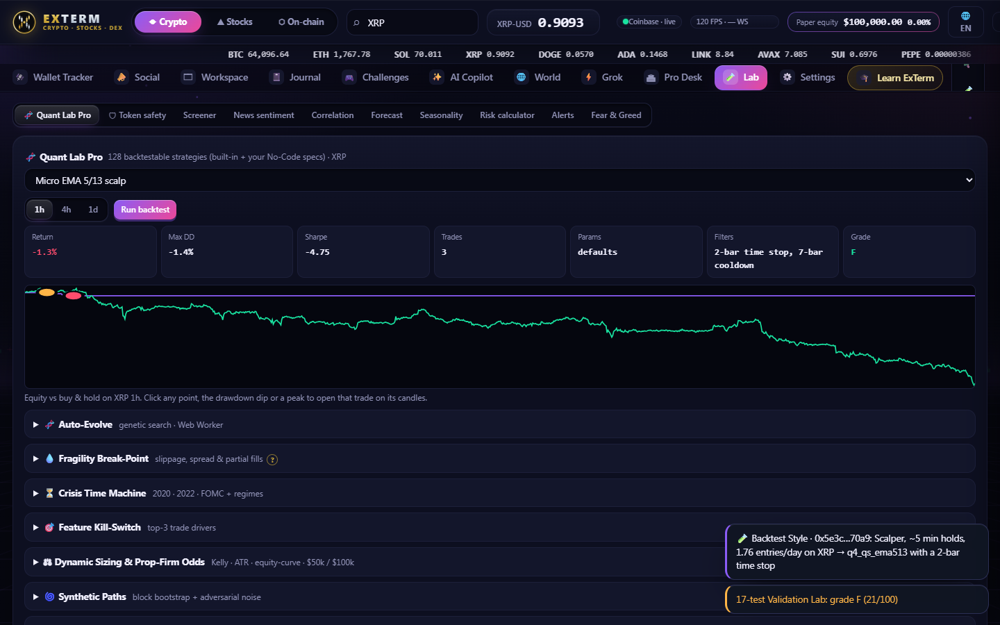
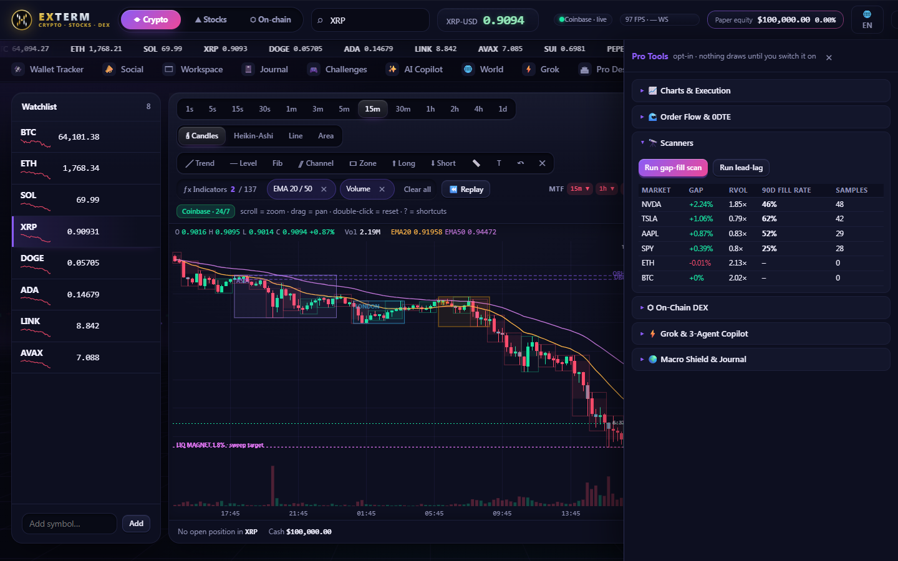
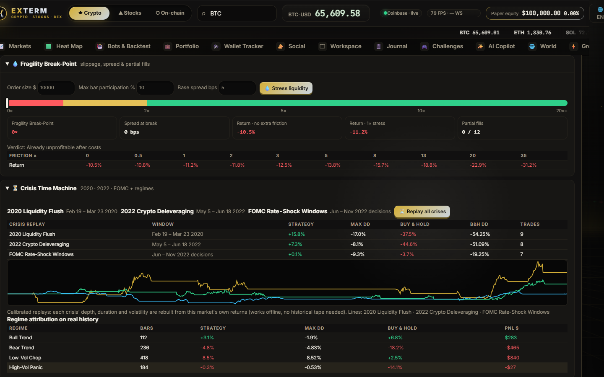
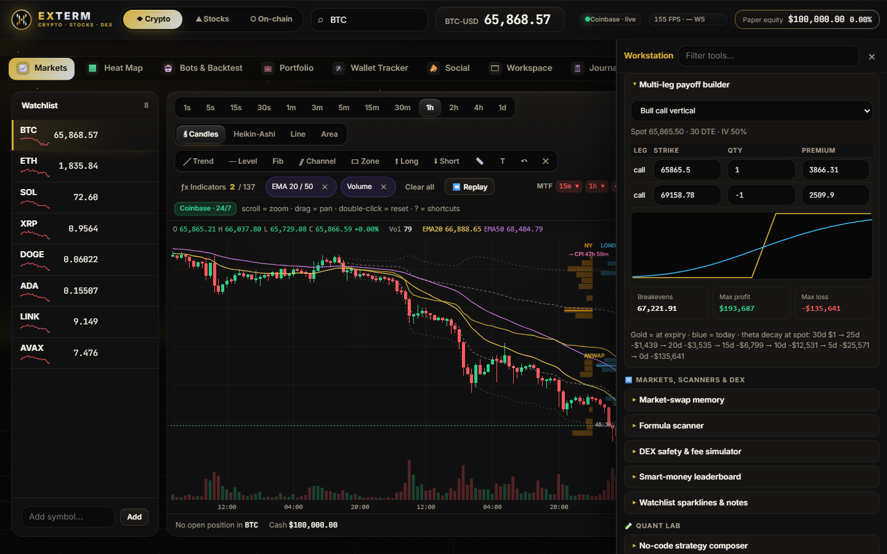
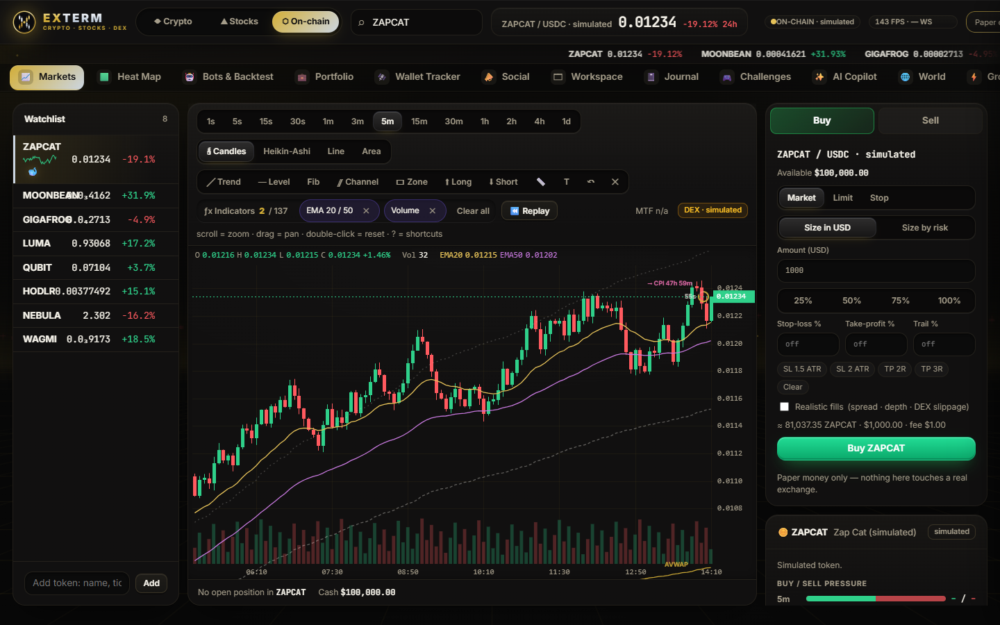
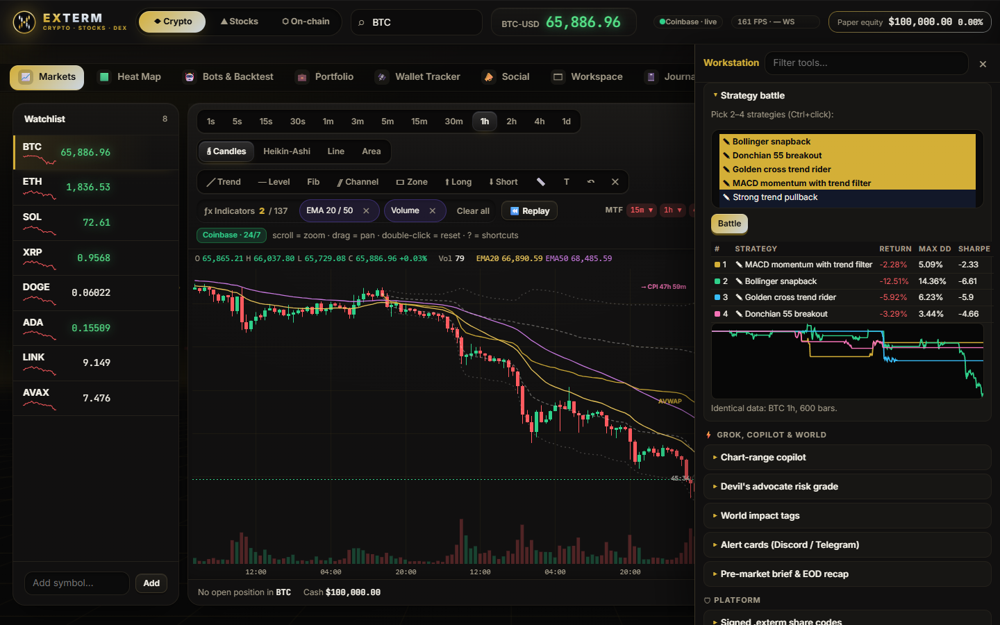
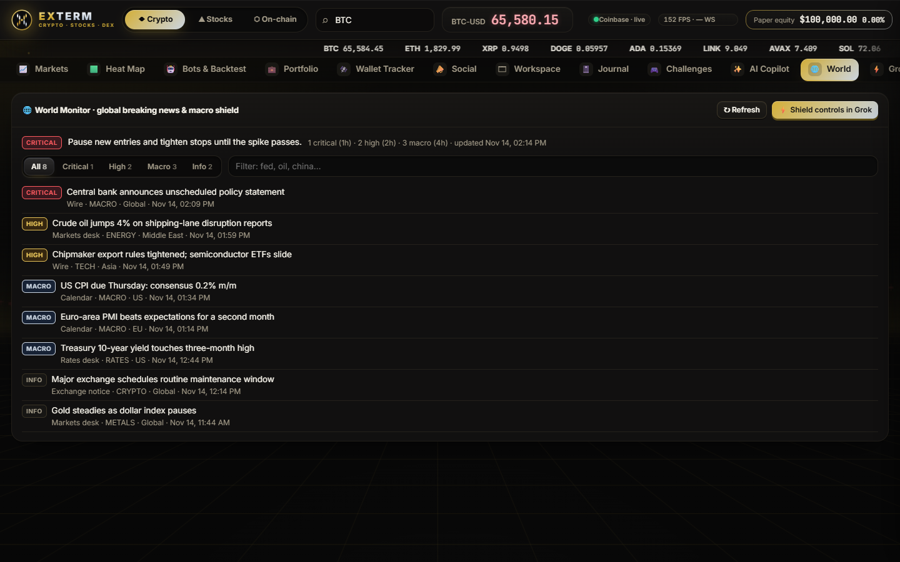

<div align="center">

# ExTerm v15.4

### Local-first trading workstation for US stocks, crypto spot & perps and on-chain DEX tokens, in one browser tab.

**Paper trading only.** Nothing in ExTerm signs or sends a real order.



**[Quickstart](#-2-second-quickstart)** · **[What's new](#-whats-new-in-v154)** · **[v15.3](#-whats-new-in-v153)** · **[v15.2](#-whats-new-in-v152)** · **[Features](#-whats-in-v151)** · **[Security](#-security)** · **[Verify a build](#-how-to-verify-official-builds)** · **[License](#-license)** · **[Brand policy](#-brand--logo-policy)**

<p>
  <a href="https://github.com/uexxx/ExTerm/releases/latest"></a>
  
  
  
  
</p>
<p>
  <a href="https://www.instagram.com/exterm.labs"></a>
  <a href="https://x.com/ExTermLabs"></a>
</p>

</div>

---

## ⚡ 2-Second Quickstart

ExTerm is one HTML file plus a small standard-library launcher. No account, no install step, no build step.

**Windows** — unzip to e.g. `C:\ExTerm`, then double-click **`start-exterm.bat`**
(it falls back to the built-in PowerShell server, `serve.ps1`, if Python isn't installed).

**macOS / Linux**

```bash
cd ~/ExTerm
./start-exterm.sh        # macOS: double-click start-exterm.command
# or directly:
python3 serve.py         # http://localhost:8765, opens Chrome
```

Useful flags: `python3 serve.py 9000` (other port) · `--no-browser` · `--doctor` (health check, add `--offline` to skip network checks).

> Opening `exterm.html` directly also works for crypto, but browsers block some stock and on-chain sources. The launcher
> proxies only an allow-list of public market-data hosts, on `localhost`, behind a fresh per-launch token.

---

## 🎓 What's new in v15.4

**Unified Master Edition: learn every tool, follow on-chain smart money, and 15 workstation upgrades, with the trading
canvas still clean.** The top bar gains one gold **🎓 Learn ExTerm** button beside Settings and the header one 🧰 icon.
Leaderboards live inside tabs you already have, and every new overlay is opt-in.

### 🎓 Learn ExTerm: Interactive Academy


- **Learn Our Terminal — Interactive ExTerm Academy**: every tab and subcategory as lesson cards with *What It Does*,
  *Step-by-Step Workflow*, *Pro Tip / Risk Guardrail*, *Keyboard Shortcut* and **Try It Live →**. That button jumps to the exact tab,
  Lab section or drawer and pulses a gold spotlight ring around the control.
- **"How do I…" fuzzy search** across 35 lessons, shortcuts and categories, plus a **5-Minute Quick-Start** track and a
  live **X / Y Modules Completed** mastery bar.
- **Learning paths**: pick *Crypto Perps*, *US Stocks & 0DTE*, *On-Chain DEX* or *No-Code Quant Bots* to get an ordered
  playlist of lessons and drills that fits in 15 minutes.
- **Start Drill sandboxes**: a seeded volatile breakout or thin DEX pool loads on the chart (tagged *SANDBOX · simulated*).
  The badge is awarded only when ExTerm sees you do the action: drag a TP rung, anchor VWAP, size by % risk or open the
  holder X-ray.
- **Explain This Metric**: a subtle **?** (or Alt+hover) on 0DTE Gamma Flip, Fragility Break-Point, ExTerm Alpha Score,
  CVD Divergence and Dealer Charm / Vanna, with *Open Full Lesson →*.
- Moving the academy into **Settings → Documentation & Academy** later means changing one constant: `LEARN_MOUNT_TARGET`.



### 🏆 On-Chain Perp & Smart-Money Leaderboards



- **Crypto → Social → Perp Trader Leaderboard** (`Feed | Perp Leaderboard`): public, permissionless Hyperliquid mainnet
  traders ranked over **24h / 7d / 30d / All** by PnL, ROI or the **ExTerm Alpha Score (0–100)**. The score blends
  risk-adjusted ROI 35%, drawdown control 25%, consistency 25% and liquid, non-churning size 15%.
- Expand any trader to see live positions (asset, side, leverage, entry, unrealized PnL, liquidation), then:
  **📐 Chart Setup** plots their entry and liquidation on your chart, **🪞 Shadow Mirror** logs their position changes as
  Grok dry-run fills (no custody, no balance touched), **+ Track Wallet**, and **🧪 Backtest Style** turns their cadence,
  hold time and favoured pair into a Quant Lab run through the 17-test gate.
- **On-chain → Wallet Tracker → Smart-Money Wallet Leaderboard**: public top-25 plus your saved wallets, ranked by win
  rate, realised PnL and Alpha Score. A **CONFLUENCE** alert and **TOP TRADER** chart pin fire when 2+ top-25 wallets
  enter the same pair and side within 15 minutes.
- Signals: **-40% Size Trimmed / SL Tightened / Full Exit** badges, **Tilted Whale** (size doubles after a losing
  streak), **Liquidation Magnet** (within 2.5% of liquidation, drawn on the chart as a sweep target), style tags
  (Scalper, Swing, Mean-Reversion, News Sniper) next to the World Macro Shield regime, a **Consensus Heatmap** strip on
  the price axis (top-25 long entries, take-profit clusters, liquidation walls), and an **Anti-Rug / Copy-Trap filter**
  that screens out dust win-rate padding, circular wash volume and bundled fills.
- The launcher proxies just two allow-listed hosts (`stats-data.hyperliquid.xyz`, `api.hyperliquid.xyz/info` with three
  read-only request types). It caches answers for 30 seconds in RAM, schema-validates them and backs off when the
  upstream rate-limits. `--offline` serves a clearly flagged seeded sample.


### 🧰 15 workstation upgrades (one Pro Tools drawer, all opt-in)

| Area | Upgrades |
|---|---|
| 📈 Charts & execution | **Ghost candles** (15m / 1h / 4h shells behind 1s / 1m bars) · **Auto-Breakeven & trailing step-ladder** (right-click a TP rung: *Move SL to Entry +0.1R on TP1 fill*, *Trail SL to TP1*; enforced on the paper position and sent to an allow-listed webhook bridge) · **Opening range (5 / 15 / 30m) + Asia / London / NY kill-zones** |
| 🌊 Order flow & 0DTE | **Tape velocity & aggressive-sweep speedometer** · **Dealer charm & vanna drift curve** with pin vs squeeze windows · **Absorption footprints** on candle bodies |
| 🔭 Scanners & DEX | **Gap-fill probability** (gap %, RVOL, 90-day fill rate) · **Holder cluster X-ray** (coordinated fresh-funded clusters vs independent buyers) · **Correlation & lead-lag decoupling** (NVDA / SMH, ETH / BTC, …) |
| ⚡ Grok & 3-Agent Copilot | **Alt+click "Why did price just move?"** forensics sent to the Copilot · **Plain-English pattern hunter** (*bullish FVG above VWAP with RVOL > 2.5x*) · **Bot cool-off & volatility throttle** (½ size after 2 losses, pause when ATR > 2.5× its 20-day mean) |
| 🌍 Macro & journal | **FOMC / CPI / NFP reaction overlay** (first-5-minute spike, fakeout, 60-minute follow-through) · **Tilt & revenge-trade guard** · **Replay My Worst Loss** in bar replay, 30 s before entry |





### 🛡 Platform
- The CSP now pins the stylesheet as well: `style-src-elem` allows only the inline `<style>` block's SHA-256 hash
  (alongside the existing script hash under `default-src 'none'`).
- 28 new UI strings in all 32 named languages, with RTL mirroring for Arabic, Hebrew, Persian and Urdu.
- New tests: `test/v154.test.js` (74 unit checks), `test/v154_server_test.py` (34 launcher checks) and
  `test/v154_e2e.js` (60 headless-Chrome checks, English and Arabic RTL).


---

## 🧬 What's new in v15.3

**Institutional Quant Lab, still uncluttered.** The Lab tab gains one 🧬 **Quant Lab Pro** pill. Inside, you pick a
strategy (every built-in strategy plus your No-Code specs), run one backtest and get a clickable equity curve. The eight
institutional tools sit in collapsed accordions and render only when you open them. Heavy runs go to a background Web
Worker, so the UI stays responsive.


| Tool | What it answers |
|---|---|
| 🧬 **Auto-Evolve** | Mutates parameters and robustness filters (trend EMA, ATR stop, cooldown, time stop) over several generations. Survivors are ranked by **out-of-sample Sharpe + Calmar**; any mutation that loses money in a walk-forward window or grades D/F in the **17-test Validation Lab** is rejected. |
| 💧 **Fragility Break-Point** | Widens spreads with volatility, adds square-root market impact for your size and partial fills above a participation cap, then shows the **exact friction multiplier where the strategy flips unprofitable**. |
| ⏳ **Crisis Time Machine** | One-click replays of the **2020 Liquidity Flush**, **2022 Crypto Deleveraging** and **FOMC rate-shock** windows, plus PnL and drawdown attribution across **Bull Trend, Bear Trend, Low-Vol Chop and High-Vol Panic**. |
| 🎯 **Feature Kill-Switch** | Scores every entry on session, RVOL, ATR percentile, RSI and VWAP distance, surfaces the **top 3 drivers** of wins vs losses, and lets you toggle filters that recalculate the equity curve instantly. |
| ⚖ **Dynamic Sizing & Prop-Firm Odds** | Replays the same trades under **Fixed Fractional, Half-Kelly, ATR volatility-targeting and Equity-Curve Trading**, with Monte Carlo odds of passing a **$50k / $100k** evaluation without breaching daily or trailing drawdown limits. |
| 🌀 **Synthetic Paths** | Hundreds to thousands of block-bootstrap paths that keep fat tails and volatility clustering but reshuffle history (optional adversarial noise), so an edge has to come from market behaviour, not memorised dates. |
| 🔍 **Equity-Curve Inspector** | Click any point, drawdown dip or peak on the curve to open that trade on its candles with entry / exit pins, **MFE / MAE** and the indicator snapshot, then jump to the same candle on the chart. |
| 👻 **Promote to Shadow Bot** | Validated strategies (grade A–C) are packaged with their strategy ID, evolved parameters and risk limits and tick in the **Grok dry-run shadow mode** on live bars. Zero capital at risk. |




---

## 🌐 What's new in v15.2

**Powerful without overwhelm.** v15.2 adds 44 workstation upgrades, but the default screen only gains three things: a
🌐 language pill, a 🧭 **Workstation** button and a subtle bar-timer ring next to the price. Everything else sits in
collapsed drawer sections (rendered only when you open them), `Ctrl+K` commands, opt-in chart overlays and **H** for
HUD clean mode.

### 🌍 First-launch language gate


The very first screen asks for your language, pre-selected from your browser. 32 languages are fully translated in the
app shell (English, Español, 中文 简体 / 繁體, 日本語, 한국어, हिन्दी, العربية, Português, Français, Deutsch, Русский, Italiano,
Türkçe, Tiếng Việt, ไทย, Bahasa Indonesia / Melayu, Polski, Nederlands, Svenska, Українська, বাংলা, اردو, فارسی, עברית,
Ελληνικά, Čeština, Română, Magyar, Filipino, Kiswahili), and every other ISO-639-1 locale is selectable with English
text. Arabic, Hebrew, Persian and Urdu switch the layout to right-to-left. The 🌐 pill switches live, any time.

### 📈 Charting & execution
Bar-timer countdown ring · crosshair / timeframe / symbol **sync groups A / B / C** across pop-out windows · draggable
**TP1 / TP2 / TP3 ladder** with % splits and automatic break-even after TP1 · optional FVG, order-block, engulfing and
liquidity-sweep labels (off by default) · **Ctrl-hold magnet** snap to candle OHLC · future FOMC / CPI / earnings markers
(add your own) · **H** HUD clean mode with a Candle X watermark · higher-timeframe picture-in-picture on 1s / 5s / 15s.

### 🌊 Order flow & options



Iceberg / spoof wall detector on crypto order books · CVD divergence markers · **click-to-anchor VWAP** with ±1σ / ±2σ
bands (or anchor to a ⚠️ MACRO pin) · Asia / London / NY session volume profiles · zero-gamma, gamma-flip and call / put
walls on the stock chart · unusual options filter with watchlist badge routing · **multi-leg payoff builder** (verticals,
straddles, strangles, iron condors) with live breakevens and a theta-decay curve.

### 🔀 Markets, scanners & DEX



Market-swap memory (timeframe, indicators and risk % per market) · **formula scanner** (`RVOL > 3 AND Price > VWAP`,
parsed, never `eval`'d) saved as tabs · DEX safety strip (mint, freeze, top-10 holders, LP lock) · smart-money leaderboard
and **multi-wallet confluence alerts** · bubble heat map in **$ net-inflow** mode (1m / 5m / 15m) · watchlist sparklines,
relative strength vs BTC / SPY and hover trade-plan notes · DEX priority-fee & slippage presets (Normal / Fast / Turbo).

### 🧪 Quant lab



No-code **IF / AND / OR composer** → Pine Script v5 or JSON · multi-asset portfolio backtester (combined Sharpe +
correlation) · parameter sensitivity heatmap (robust plateau vs overfit spike) · one-click **Fix Weak Gate** for the
17-test Validation Lab · Apex / Topstep / FTMO / custom prop rulebooks · replay speed keys **1 / 2 / 5 / 0** and a
**Blind Drill** that hides ticker and dates · journal MFE / MAE with auto-tags · 4-way strategy battle.

### ⚡ Grok, copilot & World




Plain-English **rule compiler** → backtestable workflow JSON · ask the 3-agent Copilot about a selected candle range ·
optional **devil's advocate** A–F grade before a bracket order · World headlines tagged by impact (OIL/XLE, NVDA/SMH,
BTC/DXY…) with a 1-click trade-impact switch · Discord / Telegram **alert cards with a chart snapshot** · daemon health
strip (uptime, tick latency, RAM cache hit rate, bot heartbeats) · pre-market levels brief and end-of-day recap ·
**dry-run shadow mode** that logs hypothetical fills on live ticks without touching balances.

### 🛡 Platform
ECDSA-signed **`.exterm` share codes** (tampering breaks the signature; the signer fingerprint is shown) · 1s-bar
memory governor · theme token editor on top of Obsidian & Gold · `Ctrl+K` calculator (`10000 * 0.015 / 12.5`), language
and theme switching · local data cache manager · **Settings → Verify build integrity** (on-disk hashes vs
`SHA256SUMS.txt`, live `default-src 'none'` CSP check, inline-handler scan).

---

## ✨ What's in v15.1

### 🔁 1-Click Universal Market Swap


Switch between **Crypto** (Coinbase, Kraken, Binance spot plus a paper **perps** ticket), **Stocks** (US equities and ETFs
via Yahoo Finance) and **On-chain** (DEX pools via DexScreener and GeckoTerminal) from the header. Each mode keeps
its own watchlist, selected symbol and timeframe, and the same chart, ticket, indicators and tools follow you across.

Charts draw at your display's refresh rate (an adaptive governor targets 60 – 240 Hz and steps down when frames get expensive).
One-click **workspace presets** (Alt+1…4): Scalper, On-chain Trench, Quant Lab, Macro War Room.

### 🕯 Live 1s & 5s candles

1s / 5s / 15s / 30s charts are built from every trade print (Binance `@trade`, Coinbase `matches`, Kraken `trade`), so highs
and lows move inside each second. Stock and DEX bars use each launcher quote (about one every 2 s); ExTerm never invents wicks
that didn't trade. Sub-minute charts scale to the candles on screen, with a 3 px minimum body.

### 🎯 Chart + click-to-trade, draggable SL/TP, % risk sizing

- A **+** handle on the price axis places a paper limit / stop order, alert or level at that exact price.
- Buys open a **draft bracket** with draggable **Entry**, **Stop-Loss** and **Take-Profit** lines, shaded risk/reward zones,
  live $ P&L and R-multiple. Breakeven, Partial TP 50 %, and Ctrl+Z / Ctrl+Y for line moves.
- A **% risk pill** sizes the position from your account risk and stop distance, with **Apply Size**.
- Optional **realistic fills**: spread, order-book depth impact, DEX AMM fee and slippage.

### 📊 137 indicators · 128 backtestable strategies

- **137 indicators** in a searchable picker, with editable settings and multi-timeframe trend chips.
- **128 backtestable strategies** (SMC, trend, momentum, mean reversion, breakout, volume, price action, on-chain, plus
  crypto / stocks / DEX / quant packs) and a no-code strategy builder.
- **17-test Validation Lab** that grades a strategy A–F, **walk-forward optimisation** (in-sample parameter pick,
  out-of-sample score), **Monte Carlo** (1,000 seeded trade reshuffles), risk of ruin and a candle data-quality grade.
- **Pine Script v5**: export strategies to Pine Script v5, and a **v5-compatible importer** that translates a safe subset
  (`ta.*` indicators, crossovers, comparisons, `strategy.entry` / `close`, % stops) into ExTerm's no-code format. It never
  executes the script and lists anything it skipped.

### ⚡ Dedicated Grok & World tabs

- **World** — the World Monitor feed: global breaking and macro headlines with severity counts and filters, and the live
  **Macro Shield** level. Every headline is escaped; links are limited to http(s).
- **Grok** — a tool-calling bot & workflow console: backtest, run the Validation Lab, tune, detect the regime, build an
  auto-workflow, run a journal autopsy, read macro intel and start / pause launcher bots. Works with a local quant engine
  (no key) or your own xAI key.

### 🏆 Prop-firm & Black Swan challenges

- **Prop-Firm $50K / $100K Evaluation**: +8 % target, 4 % daily loss limit, 8 % max trailing drawdown.
- **Black Swan Survival**: 2020 COVID, 2022 FTX and 2008 financial-crisis scenarios.
- Also: 10-min scalping sprint, zero-indicator price action, and a strategy → prop-challenge runner for any backtestable strategy.
- Every round earns a discipline grade (A+ to F) and an optional 1080×1080 flex card.

### 🔐 AES-256 local vault + SHA-256 CSP

- API keys and alert channels live in a **local vault**: AES-256-GCM with a PBKDF2-SHA256 key (600,000 rounds) from your passphrase.
  By default keys last for the browser session only and are never written to disk in plain text.
- **Encrypted `.exterm` backups** of everything ExTerm stores (AES-256-GCM, PBKDF2-SHA256, 600,000 rounds).
- See [Security](#-security) for the CSP and launcher hardening.

---

## 🛡 Security

- **Strict Content-Security-Policy**: `default-src 'none'`, and the single bundled script is pinned by its **SHA-256 hash**
  at build time. Injected `<script>`, inline event handlers (`onclick`, `onchange`, …) and `eval` are blocked; the source
  contains no inline handlers.
- **Escaped rendering**: all remote data (token names, news, social posts, wallet data) is HTML-escaped; links must be
  absolute `http(s)`.
- **Launcher lock-down** (`serve.py`, `serve.ps1`): listens on localhost only, fresh session token every launch, exact
  Origin + port check, Host allow-list against DNS rebinding, rate limiting, proxy allow-list with redirect re-validation
  and response size caps.
- Audit report: [`SECURITY-AUDIT.md`](SECURITY-AUDIT.md) · reporting policy: [`SECURITY.md`](SECURITY.md).

---

## ✅ How to verify official builds

Official releases are published only at **<https://github.com/uexxx/ExTerm/releases>**. Each ships a `SHA256SUMS.txt`
with relative file names. Inside the app, **Settings → Verify build integrity** does the same check through the launcher
and also confirms the live `default-src 'none'` Content-Security-Policy. That in-app check catches accidental corruption;
to rule out tampering, compare `SHA256SUMS.txt` itself with the one on the release page.

```bash
# macOS / Linux, from the ExTerm folder
sha256sum -c SHA256SUMS.txt          # macOS: shasum -a 256 -c SHA256SUMS.txt
```

```powershell
# Windows PowerShell, from the ExTerm folder
Get-Content SHA256SUMS.txt | ForEach-Object {
  $h, $f = $_ -split '\s+', 2
  if ((Get-FileHash $f -Algorithm SHA256).Hash -eq $h) { "OK   $f" } else { "FAIL $f" }
}
```

`python3 serve.py --doctor` also checks the app file against its checksum. `dist/SHA256SUMS.txt` covers every file in `dist/`.

---

## 🔧 Build

```bash
python3 build.py             # dist/exterm.html (readable) + exterm.html
python3 build.py --harden    # dist/exterm.min.html (minified with esbuild)
```

`build.py` inlines `src/*.js` and `src/style.css` into one file and stamps the CSP with the bundle's SHA-256 hash.
Tests: `powershell -ExecutionPolicy Bypass -File test\run-all.ps1` (unit, launcher and browser end-to-end suites;
needs Node 18+, Playwright and Chrome).

---

## 📜 License

Use of ExTerm is governed by the terms in **[`LICENSE`](LICENSE)**. The ExTerm name and logo are **not** licensed; see
the brand policy below.

Copyright (c) 2026 ExTerm Labs (@exterm.labs) · https://github.com/uexxx/ExTerm

## 🏷 Brand & Logo Policy

The names **ExTerm**, **ExTerm.labs**, **@exterm.labs** and the **Candle X** candlestick-and-diamond mark are reserved and
are not covered by the license. Modified versions must use their own name and logo and credit <https://github.com/uexxx/ExTerm>.
Details: **[`BRAND_GUIDELINES.md`](BRAND_GUIDELINES.md)**.

## 📣 Follow ExTerm Labs

- **Instagram:** [@exterm.labs](https://www.instagram.com/exterm.labs): demos, new features and release drops
- **X (Twitter):** [@ExTermLabs](https://x.com/ExTermLabs): updates and changelogs

Official accounts are only the ones above and <https://github.com/uexxx/ExTerm>.

---

<sub>ExTerm is an educational paper-trading tool, not financial advice. Market data comes from third-party public APIs and may
be delayed or wrong. Past backtest results do not predict future returns.</sub>
