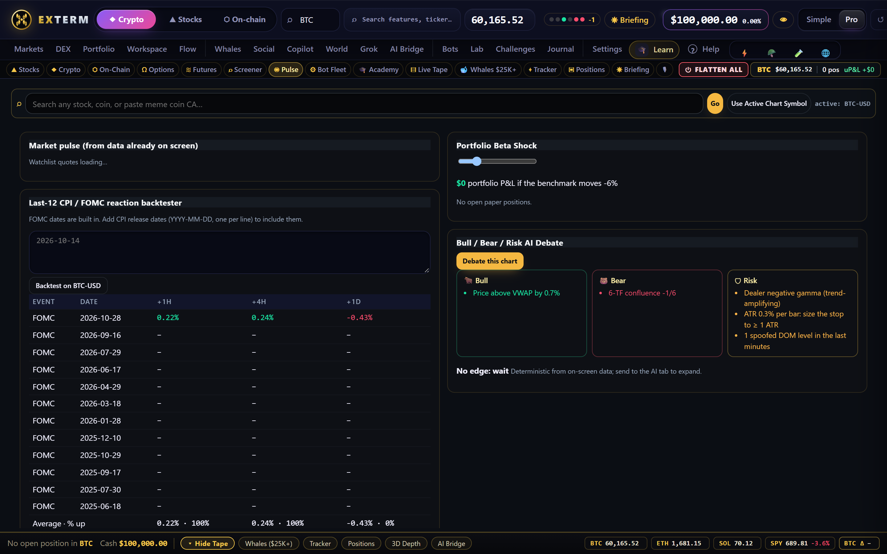
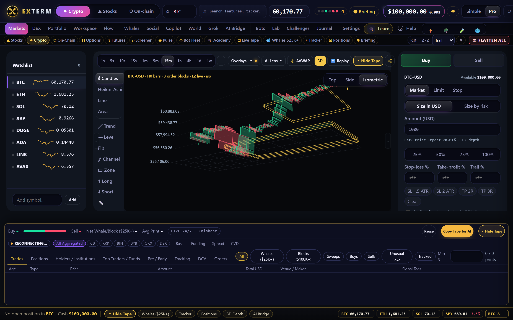
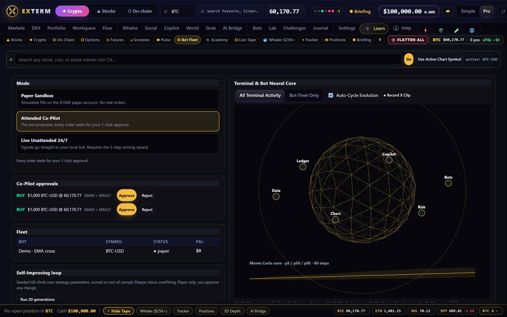
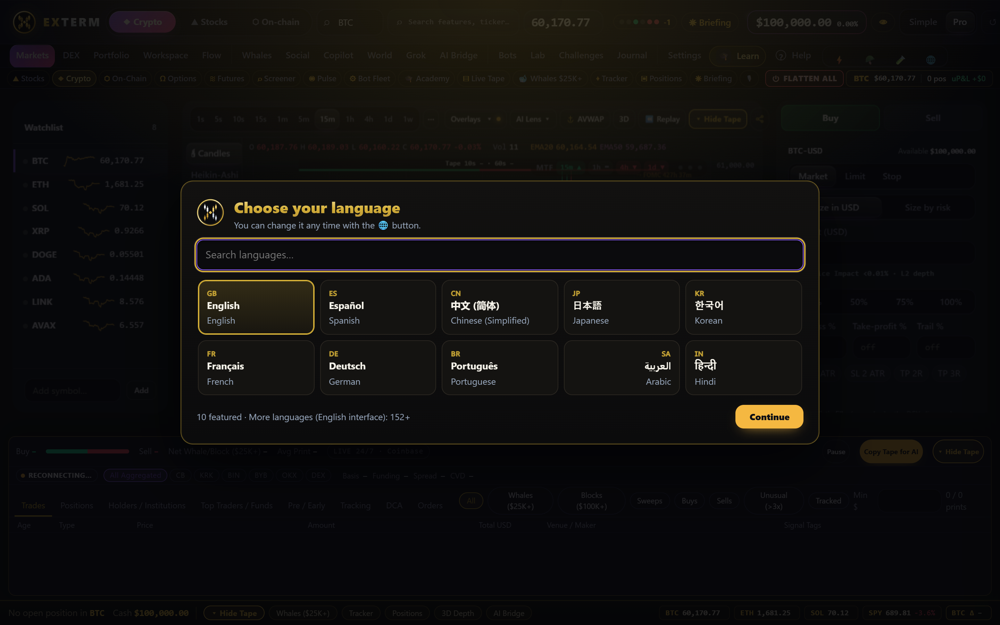

<div align="center">
  
</div>

<div align="center">

# ExTerm v17.1

### The $0, local-first trading workstation for crypto, stocks, on-chain DEX tokens, options and futures, with a Quant Lab that coaches you, a Bot Fleet you arm deliberately, and a native Android app.

**Your money never leaves your broker, exchange or wallet.** ExTerm holds no funds and no keys: it paper-trades by default,
and live signals go only to a bot you run yourself on `127.0.0.1`, HMAC-signed and locked behind a 5-step arming wizard.


**[Launch](#-30-second-local-launch)** · **[What's new](#-whats-new-in-v171)** · **[Screenshots](#-v171-tour)** · **[Android](#-android-app)** · **[Verify](#-how-to-verify-official-builds)** · **[Build & test](#-build--test)** · **[Security](#-security)** · **[License](#-license)**

<p>
  <a href="https://github.com/uexxx/ExTerm/releases/latest"></a>
  <a href="https://github.com/uexxx/ExTerm/releases/latest"></a>
  
  
  
  
  
</p>
<p>
  <a href="https://www.instagram.com/exterm.labs"></a>
  <a href="https://x.com/ExTermLabs"></a>
</p>

</div>

---

## ⚡ 30-Second Local Launch

ExTerm is one HTML file plus a small standard-library launcher. No account, no install step, no build step, no subscription.

**Windows**: unzip to e.g. `C:\ExTerm`, then double-click **`start-exterm.bat`**
(it falls back to the built-in PowerShell server, `serve.ps1`, if Python isn't installed).

**macOS / Linux**

```bash
cd ~/ExTerm
./start-exterm.sh        # macOS: double-click start-exterm.command
# or directly:
python3 serve.py         # http://localhost:8765, opens Chrome
```

**24/7 on a home PC or small VPS:** `python3 serve.py --bot-daemon --headless`, or `docker compose up -d`
(UI on the host's `127.0.0.1:8765` only). **Phone on the same Wi-Fi:** `python3 serve.py --lan` prints a pairing QR code.

Useful flags: `python3 serve.py 9000` (other port) · `--no-browser` · `--doctor` (health check, add `--offline` to skip network checks).

> Opening `exterm.html` directly also works for crypto, but browsers block some stock and on-chain sources. The launcher
> proxies only an allow-list of public market-data hosts, on `localhost`, behind a fresh per-launch token.

---

## 🎯 What's new in v17.1

**Desktop, phone (< 820 px) and the Android APK get the same build.**

- **Two header rows instead of four.** The scrolling ticker repeated the bottom strip and the group captions repeated the tabs, so both are gone. You now get one workspace bar and one Reach / filter bar, 64 px together, which gives 52 px back to the chart.
  AI Bridge and Quant Lab are now only in the nav, and 3D has moved onto the chart toolbar.
- **Contrast meets WCAG AAA.** Colours are `#07080B` base → `#0D1117` cards → `#161B22` headers, with `#F8FAFC` / `#F5C84B` primary text (≥ 7:1) and `#94A3B8` secondary labels. Nothing is smaller than 11 px.
  Sub-penny prices use subscript notation (`$0.0₅2115`), and a token with no logo gets a monogram avatar instead of a blank square.
- **Live context strip.** Every workspace except the chart shows the active symbol, its price and change, your open positions, their unrealised P&L, and NET BE. **Esc** closes the top modal or drawer.
- **Global ledger: `window.__EXTERM_LEDGER`.** Positions, resting orders, NET BE, partial take-profits and trailing-stop high-water marks are kept in one ledger, saved to IndexedDB and checked on every tick, whatever tab is open.
  Logs use fixed-size ring buffers, so memory doesn't grow in a 24/7 session.
- **Real price impact.** Every paper or bot fill is priced off an AMM `x·y=k` pool model (DEX tokens) or by walking L2 depth (crypto, stocks, futures). The ticket shows **Est. Price Impact %** as you type.
- **⏻ FLATTEN ALL (`Shift+Esc`).** One button, always visible (it floats on phones), closes every position, cancels every order, stops every bot and empties the co-pilot queue.
- **Drawings stay put.** They are stored as (epoch ms, price), so they keep their place when you switch timeframe or venue.
- **Copilot always answers.** Free-form prompts go to local Ollama (`127.0.0.1:11434`, $0) or to your own Grok, Claude, DeepSeek or OpenAI key, with the live context attached: candles, CVD, GEX, order blocks, Rug Shield, ledger and journal.
  A **Quick-Connect** card can auto-detect Ollama or take a pasted key. If no model is reachable, a deterministic local analyst replies instead of an error.
  Replies come with 1-click pills: **Plot Levels · Load in R:R Ruler · Run in Quant Lab · Queue Bot Rule Behind Firewall**.
- **Search inside every tool.** Derivs & Arb, Options, Futures, Quant Lab, Pulse, Bot Fleet, AI Bridge, Copilot, Grok and the Screener all have a **"Search any stock, coin, or paste meme coin CA…"** bar plus **Use Active Chart Symbol**.
  You switch symbol without leaving the tool.
- **Flow → Derivs & Arb works for any symbol:**
  - meme coins: cross-DEX pool arbitrage with $1K / $10K slippage per pool
  - crypto and perps: cross-exchange quotes, funding, open interest and liquidation clusters
  - US stocks: lit spread, put/call OI, IV rank, max pain, GEX walls and IV skew
- **3D on the main chart.** A **3D** pill on the toolbar works for every symbol and contract address on desktop and phone. It shows volume prisms on a calibrated floor grid, Bullion Gold order-block wireframes and L2 particle walls.
  Top / Side / Isometric camera presets, drag to rotate, double-click to reset. It follows Replay, and the canvas resizes with the chart through `ResizeObserver` at the screen's pixel ratio.
- **Bot Fleet Neural Core.** A geodesic core listens to `window.__EXTERM_BUS`: six orbiting subsystem nodes, Bezier light trails, gold / emerald / crimson shockwaves, a live telemetry ticker and a Monte Carlo cone.
  It has an **All Terminal Activity / Bot Fleet Only** filter, **Auto-Cycle Evolution** (on by default) and **Record X Clip**. It runs at the display's refresh rate (120 / 240 Hz) and drops to 0 fps when the tab is hidden.
- **Bubble Map fills ~85% of the viewport.** Labels show full tickers and live % change, and the map redraws when the window is resized.
- **Zero-stale-price lock.**
  - Failover order: DexScreener → Jupiter (Solana pools) → Coinbase / Kraken / Binance.
  - The rate-limited `solana-rpc.publicnode.com` is tried last, and launcher cooldowns are capped at 60 s.
  - If every live provider fails for more than 5 s, a crimson **STALE FEED · Xs** pill and a **DELAYED DATA** stamp appear, and Bot Fleet and live execution are locked until fresh ticks resume.

## 🎯 What's new in v17.0

Every workspace is **one click away** on the new one-line **Reach strip** under the navigation:
`Stocks · Crypto · On-Chain · Options · Futures · Screener · Pulse · Bot Fleet · Academy · Live Tape · Whales $25K+ · Tracker · Positions · Briefing` (v17.1: 3D is on the chart toolbar; Quant Lab and AI Bridge are in the nav).
Nothing new is painted over the 240 Hz / 120 Hz chart canvas: chart additions are thin lines drawn from a cached offscreen layer.

**ƒ Quant Lab Edge-Coach** (top of the Lab tab)
- Per-trade **MFE / MAE** with exit capture %, and **4 h post-exit Shadow Counterfactuals** ("exited early" / "good exit").
- **Hour × weekday win-rate heatmap** (UTC), a **0–100 Walk-Forward Overfitting Score** from anchored in-sample vs out-of-sample folds.
- **Prop-Firm Challenge simulator** for **$50K / $100K / $200K** (8% target, 5% daily, 10% max DD, 30 days; seeded Monte Carlo).
- **0.5×–3.0× ATR SL / TP R:R heatmap**: click any cell to **apply it to the chart**. **Quarter / Half / Full Kelly** sizer, **0–50 bps slippage re-sim**.
- **OHLCV CSV import**, a **Pine Script v5 inline linter**, an **Obsidian / Gold tear-sheet export**, **Send Backtest Leaks to AI Coach**,
  and **sanitized `.exterm.json` playbooks** (keys, secrets, wallets, URLs and addresses are stripped on export and import).

**⚙ Workstation (Phase 3)**
- **2-layer canvas**: an offscreen static layer repaints only when its dirty flag is set (idle tick < 0.002 ms), with **O(1) spatial-hash hit-testing** for chart labels.
- **Bot Fleet tab**: No-Bot gate + demo bot, **Paper Sandbox / Attended Co-Pilot (1-click approve) / Live Unattended 24/7**, a mandatory
  **5-step arming wizard** (risk acknowledgement · zero-overdraft settled-cash cap · max slippage bps · daily loss kill-switch · type `ARM LIVE BOT`),
  a `Float32Array` **Neural Strategy Torus** that drops to **0 fps** the moment the tab is hidden, and a seeded **Self-Improving loop**.
- **New-day Morning Briefing**: levels, movers, events, 7-day history and **1-Click Plot All Morning Levels**; reopen it from the **☀ Briefing** pill.
- **Live GEX flip / call wall / put wall** (Deribit OI for BTC / ETH / SOL, a labelled model chain otherwise), a collapsible **DOM Spoof Ladder**, a **6-TF Confluence** pill.
- **Options**: multi-leg builder, payoff at expiry with 1σ / 2σ cone, live Greeks. **Futures**: RTH / ETH volume profile (POC / VAH / VAL), tick-risk calculator, crypto liquidation clusters (estimate).
- **On-Chain Lab** in the Screener: rug / honeypot AMM simulator, block-0 sniper-bundle bubble map, smart-money leaderboard.
- **Pulse tab** (0 extra network calls): breadth, **last-12 CPI / FOMC reaction backtester**, **Portfolio Beta Shock slider (−10% ↔ +10%)**, **Bull / Bear / Risk debate**, SEC filings strip for stocks.
- **3D tab**: volumetric order blocks + L2 wall fusion + replay scrubber. Plus **2×2 multi-chart sync**, **R:R ruler**, **NET BE line**, **smart trailing stops** and **voice commands** (`Shift+V`; orders are only ever staged, never sent).

**🎓 Academy (Phase 4)**: five modules of interactive missions on the $100K paper account, covering every v17.0 tool, plus a
**Custom Drill Generator** that targets the mistake tag on most of your losing journal trades.

**📱 Polish & mobile (Phase 5)**
- **First-launch 10-language picker** (EN · ES · ZH · JA · KO · FR · DE · PT · AR-RTL · HI), saved in IndexedDB.
- Obsidian `#07080B` & Bullion Gold `#F5C84B` refinements: tabular numerals, inline depth bars, Rug Shield badges on DEX rows,
  34 px primary / 28 px sub-tabs, and **Hide Balances** (`$***,***` everywhere a balance shows).
- **Mobile app below 820 px**: 5-tab bottom dock, floating thumb-arc pill, swipe watchlist (← remove, → pin), landscape split,
  left / right-handed layout, sizing keypad, clipboard CA snipe, 1-tap **Phantom / Solflare / Jupiter / Uniswap** deep links
  (**ExTerm adds a $0 fee**; network and DEX fees still apply), QR pairing of your layout, AMOLED `#000000`, PIN or biometric lock,
  Share Setup Card and Picture-in-Picture.
- **Native Android app**: [`ExTerm-v17.1-android.apk`](https://github.com/uexxx/ExTerm/releases/latest).

**🛡 Launcher (Phases 0–1)**: a 429 storm shield (single-flight requests, per-host cool-down that honours `Retry-After`, stale
fallback), a cross-venue crypto tape (Coinbase · Kraken · Binance · Bybit · OKX) with basis, funding, spread and CVD, instant
chart switches from a RAM + IndexedDB candle cache, a Discovery formula scanner, a clipboard sniper and a supervised 24/7 daemon.

Full notes: [`CHANGELOG.md`](CHANGELOG.md).

---

## 🖼 v17.1 tour

All screenshots: 1440 × 900 at 2× (Retina), offline launcher, captured with `node tools/capture-screens.js`.


**Quant Lab Edge-Coach.** MFE / MAE and 4 h shadow outcomes per trade, the hour × weekday heatmap, and the walk-forward overfitting score.


**R:R heatmap, prop-firm simulator, Kelly and slippage.** Click a heatmap cell to put its SL / TP on the chart.



**Pulse.** Event reaction backtests, beta shock and the Bull / Bear / Risk debate, from data already on screen.


**Mandatory 5-step arming wizard.** Live Unattended mode cannot start without it.


**Morning Briefing.** Opens once each new day; one click plots every level.


**Options.** GEX walls and a multi-leg builder with payoff cone and Greeks.


**Futures.** RTH / ETH volume profile, tick risk and liquidation clusters.



**3D on the main chart (v17.1).** One toolbar pill for every symbol and CA: volume prisms, order-block wireframes, L2 walls, camera presets, double-click to reset.



**Bot Fleet Neural Core (v17.1).** Modes, co-pilot approvals and a live geodesic core wired to every subsystem on `window.__EXTERM_BUS`.


**Academy.** Five modules of missions and a drill built from your own journal.



**First-launch language picker.** Ten featured languages (Arabic right-to-left), a search box for 150+ more, saved in IndexedDB.


**On-Chain Lab.** Rug / honeypot simulation, sniper bundles and smart-money ranking.

<p align="center"></p>

**Mobile app.** Bottom dock, thumb-arc quick actions and the full chart, below 820 px and in the Android app.

---

## 📱 Android app

Download **`ExTerm-v17.1-android.apk`** from the [latest release](https://github.com/uexxx/ExTerm/releases/latest)
(Android 7.0+, about 1 MB). It runs the same single-file app from the APK's assets on a secure origin, so storage and WebCrypto
work offline. Wallet and DEX links open in your installed apps, and leaving the app keeps the chart in Picture-in-Picture.
The APK's SHA-256 is listed in the release `SHA256SUMS.txt`.

Build it yourself (JDK 17 + Android SDK `platforms;android-34` and `build-tools;34.0.0`, no Gradle):

```bash
python3 build.py --harden
python3 tools/build_apk.py          # → dist/ExTerm-v17.1-android.apk
```

CI builds the same APK on every tag: [`.github/workflows/build-android-apk.yml`](.github/workflows/build-android-apk.yml).

---

## 🛡 Security

- **Strict Content-Security-Policy**: `default-src 'none'`, and the single bundled script is pinned by its **SHA-256 hash**
  at build time. Injected `<script>`, inline event handlers and `eval` are blocked; the source contains none.
- **Escaped rendering**: all remote data is HTML-escaped; links must be absolute `http(s)`.
- **Launcher lock-down** (`serve.py`, `serve.ps1`): localhost only, fresh session token every launch, exact Origin + port check,
  Host allow-list against DNS rebinding, rate limiting, proxy allow-list with redirect re-validation and response size caps.
- **Bot Fleet**: live signals are HMAC-SHA256 signed and posted only to `http://127.0.0.1` / `localhost`; every order passes the
  settled-cash cap, max-slippage and daily-loss checks. Playbook files are sanitized both ways.
- Audit report: [`SECURITY-AUDIT.md`](SECURITY-AUDIT.md) · reporting policy: [`SECURITY.md`](SECURITY.md).

---

## ✅ How to verify official builds

Official releases are published only at **<https://github.com/uexxx/ExTerm/releases>**. Each ships a `SHA256SUMS.txt`
with relative file names. Inside the app, **Settings → Verify build integrity** does the same check through the launcher.
To rule out tampering, compare `SHA256SUMS.txt` itself with the one on the release page.

```bash
# macOS / Linux, from the ExTerm folder
sha256sum -c SHA256SUMS.txt          # macOS: shasum -a 256 -c SHA256SUMS.txt
```

```powershell
# Windows PowerShell, from the ExTerm folder
Get-Content SHA256SUMS.txt | ForEach-Object {
  $h, $f = $_ -split '\s+', 2
  if ((Get-FileHash $f -Algorithm SHA256).Hash -eq $h) { "OK   $f" } else { "FAIL $f" }
}
```

---

## 🔧 Build & test

```bash
python3 build.py             # dist/exterm.html (readable) + exterm.html
python3 build.py --harden    # dist/exterm.min.html (minified with esbuild)
node test/v170.test.js       # v17.0 unit suite
node test/v171.test.js       # v17.1 unit suite (ledger, AMM/L2 impact, stale guard, Copilot routing)
node test/v17pro_e2e.js      # v17.0 + v17.1 browser end-to-end (desktop 1440/1280 + phone 390)
```

`build.py` inlines `src/*.js` and `src/style.css` into one file and stamps the CSP with the bundle's SHA-256 hash.
All suites: `powershell -ExecutionPolicy Bypass -File test\run-all.ps1` (unit, launcher and browser end-to-end; each browser
suite opens and closes its own headless Chrome, one at a time; needs Node 18+, Playwright and Chrome).

---

## 📜 License

**Proprietary — All Rights Reserved.** ExTerm v17.0 and later are governed by **[`LICENSE`](LICENSE)**.

> Copyright (c) 2026 ExTerm Labs. All Rights Reserved. Free for personal, non-commercial use. Copying, modifying,
> reverse-engineering, cloning, or redistributing source or derivative works without express written permission from
> ExTerm Labs is strictly prohibited.

The ExTerm name and logo are **not** licensed; see the brand policy below.

## 🏷 Brand & Logo Policy

The names **ExTerm**, **ExTerm.labs**, **@exterm.labs** and the **Candle X** candlestick-and-diamond mark are reserved and
are not covered by the license. No modified or redistributed version may be published without written permission.
Details: **[`BRAND_GUIDELINES.md`](BRAND_GUIDELINES.md)**.

## 📣 Follow ExTerm Labs

- **Instagram:** [@exterm.labs](https://www.instagram.com/exterm.labs): demos, new features and release drops
- **X (Twitter):** [@ExTermLabs](https://x.com/ExTermLabs): updates and changelogs

Official accounts are only the ones above and <https://github.com/uexxx/ExTerm>.

---

<sub>ExTerm is an educational paper-trading tool, not financial advice. Market data comes from third-party public APIs and may
be delayed or wrong. Model outputs (GEX model chain, liquidation clusters, prop simulations) are estimates. Past backtest results
do not predict future returns.</sub>
