<div align="center">

# ExTerm v16.3

### The $0, local-first trading workstation: multi-asset charting at up to 240 Hz, quant research, 3D market structure and a zero-custody live execution cockpit, in one browser tab.

**Your money never leaves your broker, exchange or wallet.** ExTerm holds no funds and no keys: it paper-trades by default, and live
signals go only to a bot you run yourself on `127.0.0.1`, signed, checked by ten risk engines and locked behind four gates.


**[30-second launch](#-30-second-local-launch)** · **[What's new](#-whats-new-in-v163)** · **[Charting](#1--240-hz-multi-asset-charting--direct-order-execution)** · **[Live cockpit](#2--closed-loop-zero-custody-live-execution-cockpit-127001)** · **[3D](#3--pure-canvas-3d-market-structure-5-engines-zero-3d-libraries)** · **[Quant Lab](#4--17-test-statistical-quant-lab--strategy-studio)** · **[Global](#5--on-chain-whale-intelligence-32-languages--rtl-and-learn-exterm)** · **[Security](#6--browser-security-hardening--verification)** · **[Release history](#-release-history)** · **[Verify a build](#-how-to-verify-official-builds)**

<p>
  <a href="https://github.com/uexxx/ExTerm/releases/latest"></a>
  
  
  
  
  
</p>
<p>
  <a href="https://www.instagram.com/exterm.labs"></a>
  <a href="https://x.com/ExTermLabs"></a>
</p>

</div>

---

## ⚡ 30-Second Local Launch

ExTerm is one HTML file plus a small standard-library launcher. No account, no install step, no build step, no subscription.

**Windows**: unzip to e.g. `C:\ExTerm`, then double-click **`start-exterm.bat`**
(it falls back to the built-in PowerShell server, `serve.ps1`, if Python isn't installed).

**macOS / Linux**

```bash
cd ~/ExTerm
./start-exterm.sh        # macOS: double-click start-exterm.command
# or directly:
python3 serve.py         # http://localhost:8765, opens Chrome
```

Useful flags: `python3 serve.py 9000` (other port) · `--no-browser` · `--doctor` (health check, add `--offline` to skip network checks).

> Opening `exterm.html` directly also works for crypto, but browsers block some stock and on-chain sources. The launcher
> proxies only an allow-list of public market-data hosts, on `localhost`, behind a fresh per-launch token.

**What ExTerm is:** a terminal for **crypto spot & perps, US stocks, on-chain DEX tokens, options and futures** with
professional charting, 137 indicators, 128 backtestable strategies, a statistical Quant Lab, on-chain whale intelligence and
five pure-canvas 3D views. Everything runs on your computer. Trading is **paper by default**. When you choose to go live,
ExTerm sends signed intents to **your own** local bot, and that bot talks to **your own** broker, exchange or wallet: ExTerm
never touches the money.

---

## 🎯 What's new in v16.3

> **Closed-Loop Live Cockpit.** v16.3 closes the loop between the chart and your local bot.
>
> - 🛰 **Floating Live Execution HUD**: `LIVE ARMED · Slot # · ping ms · Day P&L vs -$cap`, a 44px equity & drawdown sparkline and a market-close / funding countdown.
> - ⏸ **Pause New Entries (Keep Exits Active)** and a live **`Cooldown: 11m 42s`** countdown inside the disabled Buy button.
> - 🎯 **Focus Chart (`F`)**, a docked **Micro-Ticket** strip, and a **Position & Pending Orders Drawer** (`Close 50%` · `Flatten` · `Reverse Position` · `Close Losing / Green Legs`).
> - 🔁 **Two-way `127.0.0.1` ACK + fill sync**: bot position sync, heartbeat latency & packet-success graph, **slippage & fill quality by symbol**, and ~40-line starter bridges for **Interactive Brokers, Alpaca, CCXT and Freqtrade**.
> - 🛡 **Require Stop-Loss ON by default**, $ risk → exact quantity, **R:R & $ badges**, **BE pill**, Auto-BE on TP1, 3× depth, stale-quote freeze, trades-per-hour limit, drawdown throttle, per-slot ticker allowlist.
> - 🔐 **Two-Key Arming (`Shift + Alt + A`)**, **3-Second Live Readiness Self-Check**, time-in-trade exit, EOD Flat Timer, conditional triggers, an AES-256-GCM session snapshot and **Reset Session Safety Counters** (PAPER only).
> - 📈 **Active-tick sub-minute bars**: a quiet second never draws a flat filler candle on stocks or on-chain tokens.
>
> Full notes: [`CHANGELOG.md`](CHANGELOG.md) · earlier versions: [Release history](#-release-history)

---

## 🧭 Complete functional overview

### 1 · 240 Hz multi-asset charting & direct order execution

One chart engine for **Crypto, US Stocks, On-chain DEX tokens, Options and Futures**. It draws at your display's refresh
rate (an adaptive governor targets 60–240 Hz and steps down when frames get expensive).

- **Every timeframe, every market:** `1s · 5s · 10s · 15s · 1m · 5m · 15m · 30m · 1h · 4h · 1d · 1w · 1M` with true-form,
  gapless candles. Sub-minute bars are **active-tick**: a bar is only added when price or volume actually changed.
- **137 indicators** (EMA, SMA, VWAP, Bollinger Bands, RSI, MACD, ATR, Donchian and more), multi-timeframe trend pills and
  drawing tools (trend, level, Fib, channel, zone, long / short).
- **Trade on the chart:** click to place Entry, Stop-Loss and Take-Profit, drag any line, **R:R and $ P&L badges** while
  you drag, dollar tags on the price axis, a one-click **BE** break-even pill, Auto-BE on TP1, TP1 50% / TP2 30% / TP3 20%
  scale-out, trailing-stop activation lines, fill markers with slippage in bps, and a bid/ask spread tunnel on 1s–1m.
- **Order ticket:** market / limit / stop, **$ Risk → exact quantity** sizer, GTC / IOC / Post-Only, **Chase Limit** (peg to
  best bid / ask), a **liquidation & margin-buffer** pill, a pre-trade market-close / funding countdown and one-click
  **Copy Trade Setup**. Hotkeys: `Shift+B` buy · `Shift+S` sell · `Shift+X` cancel all.
- **Precision tools:** `Shift + drag` **Measure Dragger** (Δ$, %, bars, time, volume), the **ExTerm Chart Context Menu**
  (right-click for price-aware orders, alerts and levels), Alt + drag magnetic snap to high / low / VWAP, a Scale-In / Pyramid
  ghost line and a Fee & Funding / Borrow drag line.

### 2 · Closed-loop zero-custody live execution cockpit (`127.0.0.1`)


ExTerm never holds your funds or keys. Live mode sends **HMAC-SHA256 signed** intents (fresh session key, 3-second expiry,
unique idempotency key, rising sequence number) to a bot **you** run on `127.0.0.1` (or an allow-listed private LAN host over
HTTPS). Your bot replies with an **ACK + fill**, and ExTerm reconciles it.

- **Six local adapter slots:** script runner, JSON webhook relay, socket / IPC bridge, perp DEX wallet signer, equities /
  futures gateway and a graduated shadow-to-live mirror.
- **Starter bridges** (Execution Bridge → *Local broker starter bridges*): copy or download ~40 lines of Python for
  **Interactive Brokers**, **Alpaca**, **CCXT** or **Freqtrade**. Each verifies the signature, refuses replays, executes and
  replies `{ ok, ack, fill }`.
- **Cockpit:** Floating Live Execution HUD, Focus Chart (`F`), Micro-Ticket, Position & Pending Orders Drawer, **Live-Only
  Workspace Mode** (`body.live-bot-armed` hides paper-only tools), watchlist **Signal Readiness** dots, acoustic and visual
  confirmation cues with instant mute, and a **privacy-masked trade card** (R, % and holding time only) on every close.
- **Arming:** four gates (healthy heartbeat, risk caps set, disclosure acknowledged, exact phrase), optional **Two-Key
  Arming** (`Shift + Alt + A`, then Arm within 10 s), a **3-Second Live Readiness Self-Check**, and `Ctrl+Shift+K` to
  flatten everything and disarm.

**The 10-engine security & risk lockdown**

| # | Engine | What it does |
|---|---|---|
| 1 | `Require Stop-Loss` | ON by default: every live opening order needs a stop (long below entry, short above). Closes and flatten never blocked. |
| 2 | `Signal Firewall` | Schema check, fat-finger `Max Single-Order Notional`, SSRF-safe endpoint check (loopback / allow-listed LAN only). |
| 3 | `Signed Envelopes` | HMAC-SHA256 with a per-session key, 3 s TTL, idempotency key, nonce cache and rising sequence: replays are rejected. |
| 4 | `Depth & Stale-Quote Guard` | Order-book depth within 0.5% of mid must be `≥ 3×` the order; quotes older than 5 s (crypto) / 20 s (stocks) / 90 s (on-chain) freeze entries. |
| 5 | `Rate & Exposure Caps` | `Max Trades-Per-Hour` and a global 6-slot exposure cap. |
| 6 | `Drawdown Throttle & Cooldown` | Size cut to 50% after 2 losses in a row; a loss-streak cooldown pauses entries with a visible countdown. |
| 7 | `Correlation & Thin-Hours Guard` | Refuses positions correlated above `r = 0.85` with an open one; halves the spread cap on weekends and outside US hours. |
| 8 | `Execution Shield` | Spread ceiling, per-slot ticker allowlist and `Pause New Entries (Keep Exits Active)`. |
| 9 | `Max Daily Loss Auto-Flatten` | Breaching the daily cap broadcasts `CANCEL_ALL_AND_FLATTEN` and locks all six slots to PAPER. |
| 10 | `Dead-Man's Switch & Kill-Switch` | Missed heartbeats, idle auto-disarm, EOD Flat Timer, time-in-trade exit and `Ctrl+Shift+K` all flatten and disarm. |

Every decision lands in the **Signed Signal Receipt Ledger** (CSV / JSON export with timestamp, idempotency key and signature).

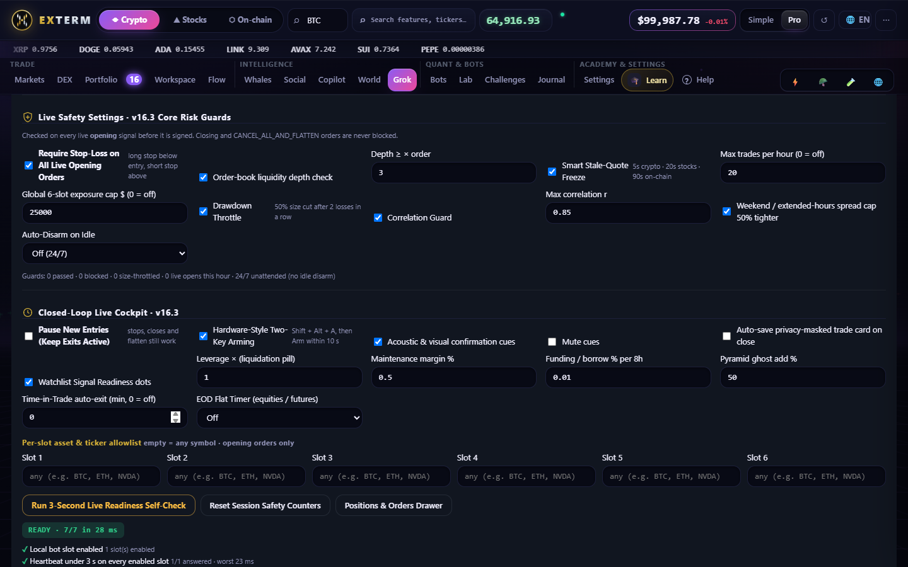

### 3 · Pure-canvas 3D market structure (5 engines, zero 3D libraries)

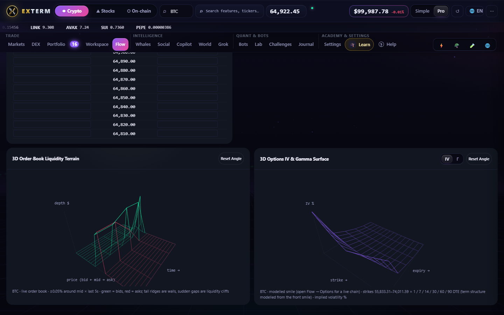

Five rotatable 3D views written on plain `<canvas>` (drag or arrow keys to rotate, **Reset Angle** to return). Each pauses
when off-screen:

- **Order-Book Liquidity Terrain**: depth over time; walls are ridges, gaps are cliffs.
- **Options IV & Gamma Surface**: implied volatility (or $ gamma) by strike and expiry.
- **Quant Lab Profit Mountain**: a 7 × 7 stop / target sweep that shows plateau vs. spike.
- **Multi-Asset Correlation Orbit**: rolling correlations and market regime.
- **Whale Liquidation Cluster Orbit**: where large positions would be forced out.

### 4 · 17-test statistical Quant Lab & Strategy Studio

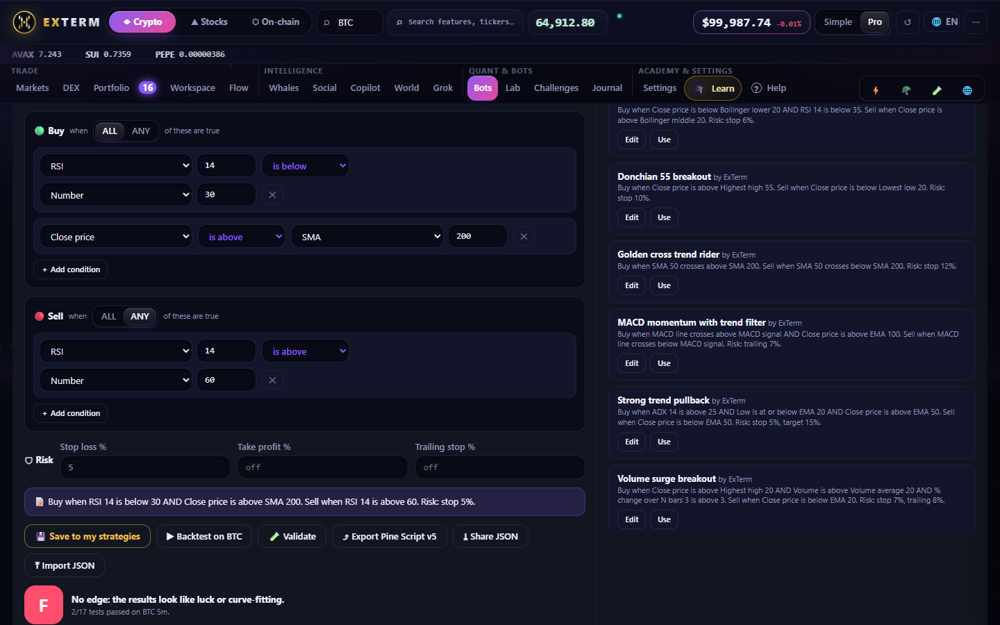

- **Visual IF / AND / OR builder** with templates and a community library, exporting to **Pine Script v5** or JSON, plus a
  v5-compatible importer for a safe subset.
- The **17-test Validation Lab** grades every strategy A–F (the screenshot shows an honest F: the idea has no edge on that
  data). It covers **walk-forward** optimisation (in-sample pick, out-of-sample score), **Monte Carlo** (1,000 seeded
  reshuffles), **risk of ruin**, slippage fragility and a candle data-quality grade.
- **Genetic parameter search** (Auto-Evolve) keeps only mutations that survive walk-forward and grade C or better;
  Crisis Time Machine and synthetic stress paths; a portfolio backtester; prop-firm odds; and a Bot Net Profit hero card
  with fees and slippage deducted.
- Promote a validated bot to **Shadow** (dry-run on live ticks), then to the live mirror slot.

### 5 · On-chain whale intelligence, 32 languages + RTL and Learn ExTerm

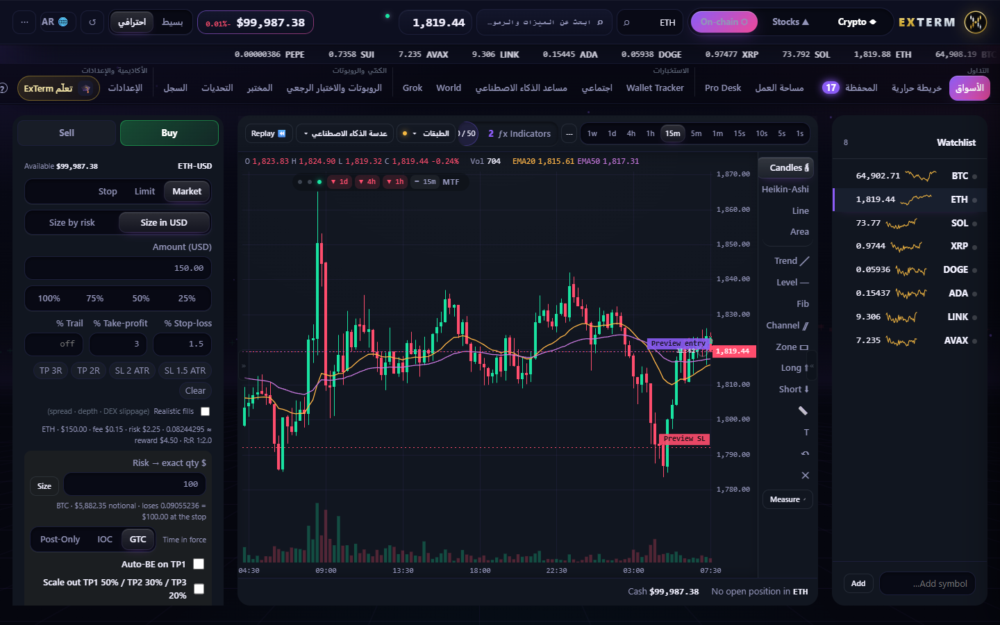

- **On-chain:** DEX tokens on several chains, a Launch Radar, token safety scanner, wallet tracker, smart-money and perp
  leaderboards with Trader Detail & Mirror, and a whale & liquidation cluster view.
- **32 languages** with full **right-to-left** mirroring (for example Arabic) and an ISO-639 fallback, chosen at first launch.
- **Learn ExTerm**: an interactive academy with **35 lessons**, sandbox drills on simulated charts, a 5-minute quick-start
  track and "How do I…" fuzzy search.

### 6 · Browser security hardening & verification

- **Strict CSP:** `default-src 'none'`; the bundled script is pinned by its **SHA-256** hash at build time. No inline
  handlers, no `eval`, every dynamic string HTML-escaped.
- **Local storage encryption:** API keys and alert channels sit in an **AES-256-GCM** vault (PBKDF2-SHA256), encrypted
  `.exterm` backups, and the v16.3 session snapshot (AES-256-GCM, passphrase never stored).
- **Locked-down launcher:** localhost only, fresh session token every launch, Origin + Host checks, rate limits and a
  proxy allow-list. Live bots are reachable on loopback or an allow-listed private LAN host only.
- **Verify every download** against `SHA256SUMS.txt` (see [below](#-how-to-verify-official-builds)), or use **Settings →
  Verify build integrity**.

---

## 📚 Release history

The sections below document every earlier release. All of these capabilities are still in v16.3.

## 🎯 What's new in v16.2

**Universal timeframes, true-form sub-minute candles everywhere, Max Daily Loss auto-flatten, a launch safety briefing and a live-only workspace.**
Every v16.1 capability is still here in PAPER, and ExTerm still holds no funds and no keys.

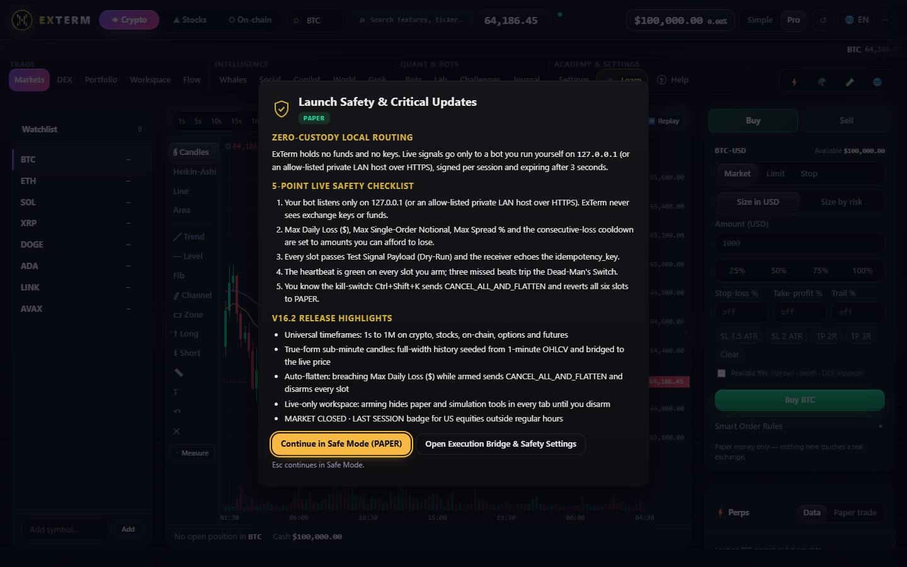

### 🛡 Launch Safety & Critical Updates briefing (every start)
Every fresh launch, in PAPER or with live routing armed, opens a short briefing: zero-custody `127.0.0.1` routing, the
**5-Point Live Safety Checklist** and the v16.2 highlights. **Continue in Safe Mode (PAPER)** (or `Esc`) keeps you in PAPER;
if live routing was armed, it flattens and disarms all six slots. **Open Execution Bridge & Safety Settings** takes you to the bridge.

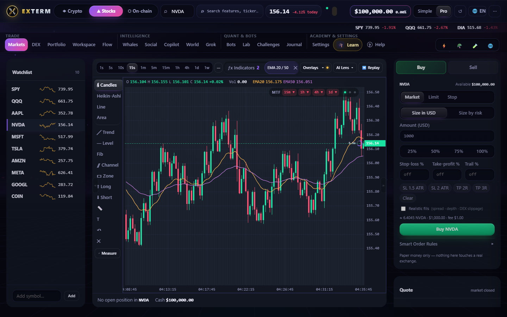

### ⏱ Universal timeframes and true-form sub-minute candles
- `1s` `5s` `10s` `15s` `1m` `5m` `15m` `1h` `4h` `1d` `1w` quick pills, and `30s` `3m` `30m` `2h` `1M` behind `⋯`, on crypto, stocks, on-chain, options and futures alike.
- Stocks and on-chain tokens rarely trade every second. The `1s`–`15s` window is now back-populated from the symbol's recent 1-minute OHLCV and
  bridged smoothly to the current price, so the chart is full-width from the first frame and EMA 20 / 50 start at the left edge.
  This works from `$284.64` large caps to 8-decimal micro-caps such as `0.000001088`. Real tick bars replace seeded ones as they arrive.
- Live ticks keep gapless `Open = previous Close` aggregation. Sub-minute charts keep a minimum price span of 0.20 % of price, so quiet seconds never collapse into dashes.
- **MARKET CLOSED · LAST SESSION** badge next to the feed pill for US equities outside regular hours; the chart shows the last session.

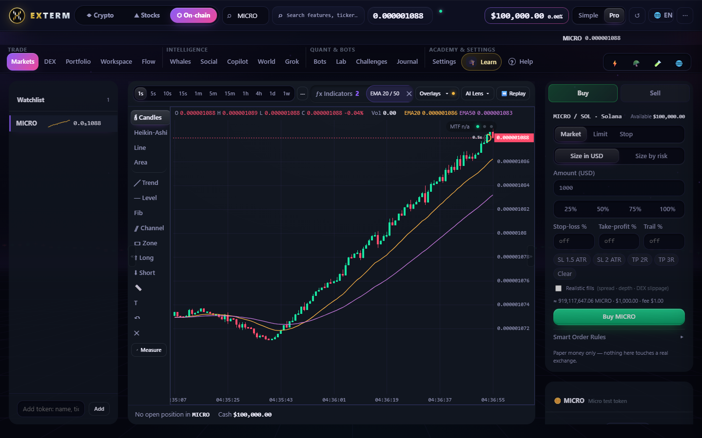

### 🧯 Max Daily Loss ($) auto-flatten
While any slot is armed, ExTerm checks realised + unrealised session drawdown every second. When it reaches your **Max Daily Loss ($)**,
a signed `CANCEL_ALL_AND_FLATTEN` goes to every armed local bot, all six slots revert to PAPER, the breach is written to the
Signed Signal Receipt Ledger, and a circuit-breaker alert explains what happened. The Portfolio tab shows a live loss gauge while armed.

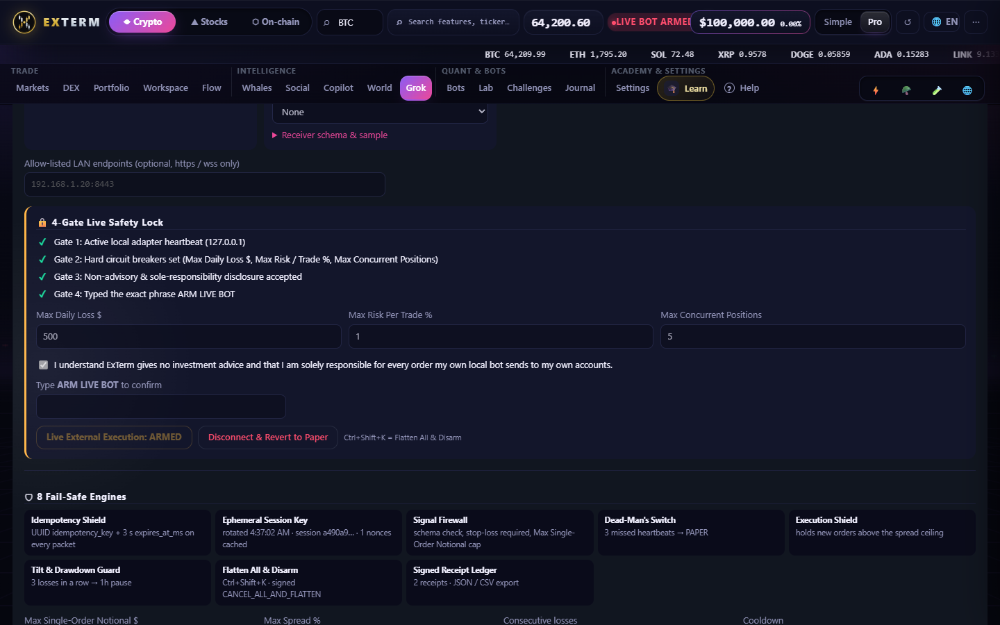

### 🔴 Live-only workspace (`body.live-bot-armed`)
Arming live routing hides paper and simulation tools in every tab until you disarm: Tick Replay (button and context-menu entry), paper
balance resets, Genetic Auto-Evolve, Crisis Time Machine, synthetic stress paths, walk-forward / Monte Carlo, the 3D Profit Mountain,
Backtest Style and Learn practice drills (behind a **LIVE BOT ARMED — Practice Drills Paused** banner). Live candles, indicators, chart
order lines, the context menu's live actions, the Measure Dragger, the order ticket, positions, the order book, CVD, tape, the 3D terrain, IV
surface and whale orbit, the six bridge slots, heartbeats, circuit breakers and **Flatten All & Disarm** (`Ctrl+Shift+K`) stay.

---

## 🎯 What's new in v16.1

**Chart click / drag trading, a price-aware right-click menu, a precision measure ruler and eight bot fail-safe engines.**
Every v16.0 capability is still here, and ExTerm still holds no funds and no keys.

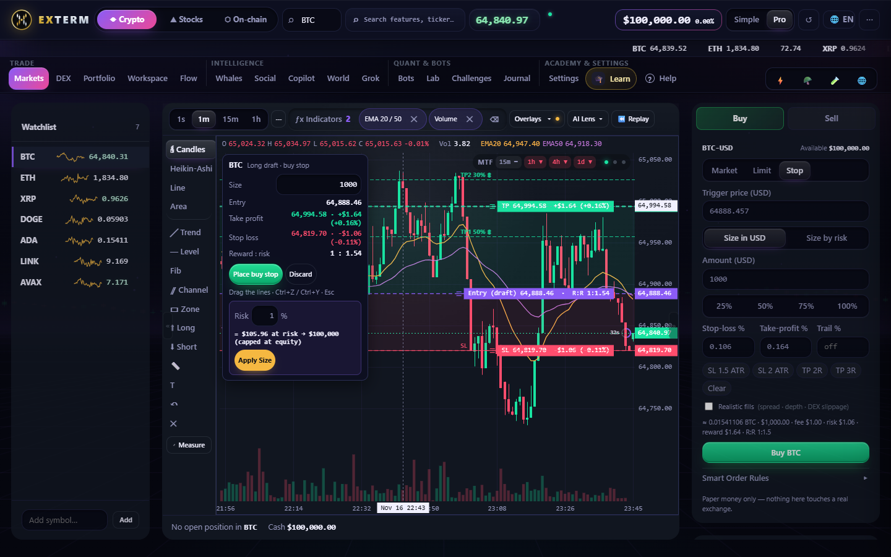

### 📈 Chart click-to-trade, done precisely
- One exact `chart.priceToY` / `chart.yToPrice` mapping is shared by clicks, line drags, the menu and the ruler, on every
  timeframe from `1s` to `1h`.
- Dragging the **Entry**, **Stop-Loss** or **TP** line updates the live `$` / `%` risk readout and keeps the order ticket
  (limit price, SL %, TP %) in step. TP1–TP3 ladder rungs stay draggable.
- Non-interactive chart overlays use `pointer-events: none`, so every click reaches the chart hit-tester.

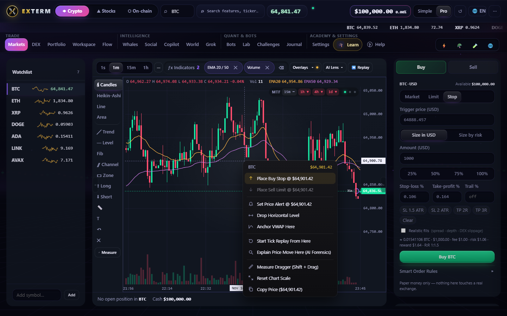

### 🖱 ExTerm Chart Context Menu (right-click the chart)
The browser's "Save image as" menu no longer opens on the chart. You get a price-aware menu at the cursor instead. It flips at the
screen edges, supports the arrow keys, and closes on `Esc` or an outside click:
**Place Buy Limit / Stop @ $Price** · **Place Sell Stop / Limit @ $Price** · **Set Price Alert @ $Price** ·
**Drop Horizontal Level** · **Anchor VWAP Here** · **Start Tick Replay From Here** · **Explain Price Move Here (AI Forensics)** ·
**Measure Dragger** · **Reset Chart Scale** · **Copy Price ($Price)**. Right-clicking a TP rung still opens the step-ladder menu.

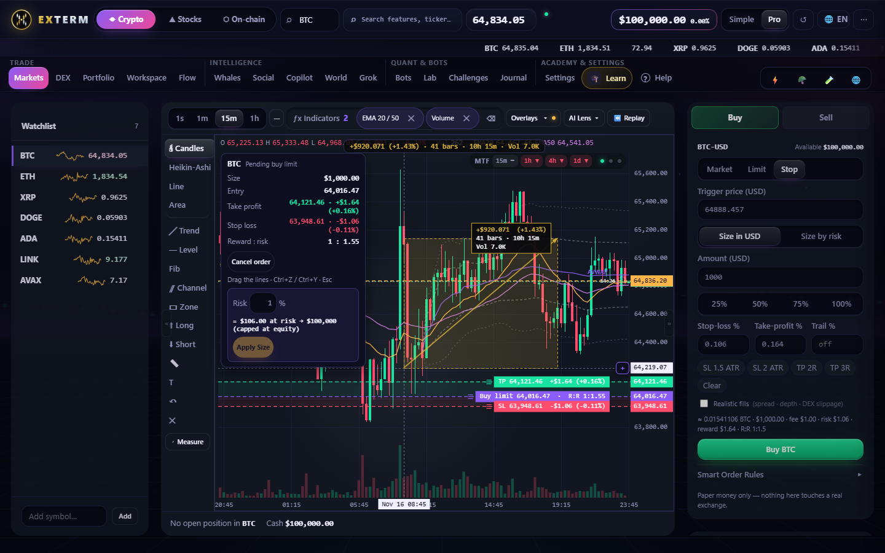

### 📏 Precision Measure Dragger (`Shift` + drag, or the **Measure** toolbar toggle)
A gold zone (price up) or crimson zone (price down) shows the exact **Δ$**, **%**, **bar count**, **elapsed time** and
**cumulative volume** in tabular figures. It draws on a light top canvas, so the candle layer keeps its full refresh
rate, and it stays attached to its prices and times when you pan or zoom. `Shift` + drag never pans the chart. `Esc` clears it.

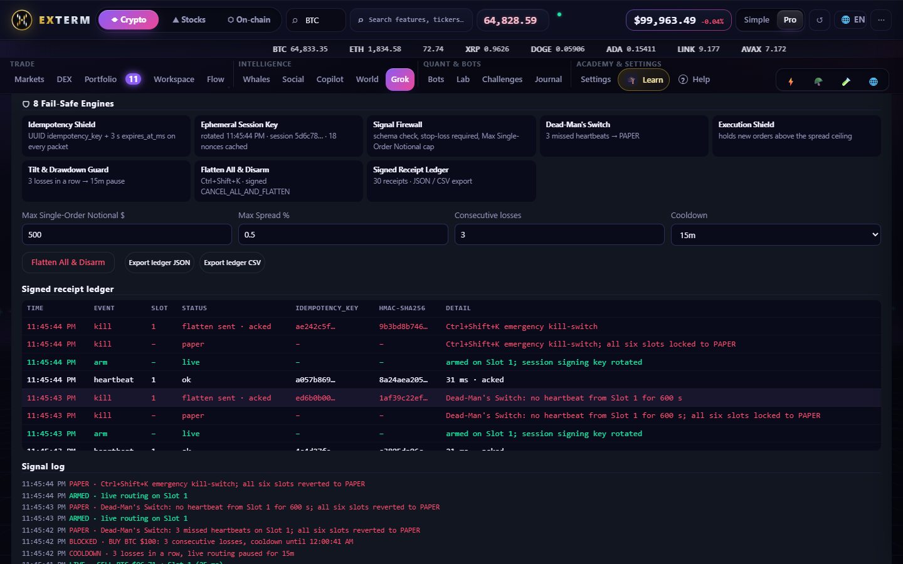

### 🛡 8 live bot security & fail-safe engines
| # | Engine | What it does |
|---|---|---|
| 1 | **Idempotency Shield + Dead-Man's Switch** | Every outbound packet carries a UUID `idempotency_key` and `expires_at_ms` (3 s TTL). Three missed heartbeats, or a stalled heartbeat loop, auto-disarm to PAPER. Each slot has a **Test Signal Payload (Dry-Run)** button that shows the signed JSON and checks the receiver's `ack`. |
| 2 | **Ephemeral session key + anti-replay cache** | Packets are signed with `HMAC-SHA256(slot secret, "ExTerm-session-v2|" + session)`. A fresh session is drawn on every boot and every arm. Used keys are tracked in a rolling nonce cache, so a replayed packet is rejected. |
| 3 | **Signal Firewall** | Blocks `NaN` / `Infinity`, negative or zero sizes, invalid symbols, missing or inverted stop-losses, and any opening order above your **Max Single-Order Notional $** cap. |
| 4 | **Execution Shield** | Holds new orders while the live bid-ask spread is above your `%` ceiling. |
| 5 | **Tilt & Drawdown Guard** | Pauses live routing for `15m`, `1h` or `24h` after `N` consecutive losing trades. |
| 6 | **Flatten All & Disarm** | `Ctrl+Shift+K` or the panel button sends a signed `CANCEL_ALL_AND_FLATTEN` to every armed adapter, then locks all six slots back to PAPER. |
| 7 | **Signed Receipt Ledger** | Records every signal, heartbeat, breaker trip, arm and kill event with its timestamp, `idempotency_key` and HMAC-SHA256 signature. One-click JSON / CSV export. |
| 8 | **Discipline Attribution** (Journal) | Tags every closed trade **Followed Plan**, **Moved Stop Wider**, **Over-Size Risk** or **Early Exit**, and shows the net `$` from disciplined trades vs. rule violations. |

Closing orders are never blocked by the notional cap, the spread breaker or the cooldown, because they only reduce exposure.
The launcher's `/hook` gateway now forwards only to `127.0.0.1` / `localhost`, or to a private-LAN `https` host:port you list in
`EXTERM_HOOK_ALLOW`. Third-party services are refused.
## 🔌 What's new in v16.0

**Six local external bot bridges behind a four-gate live safety lock.** Every v15.7 capability is still here. ExTerm
still holds no funds, no keys and runs no servers: it can now hand HMAC-signed signals to a bot **you** run on your own
machine, and only after four deliberate steps.

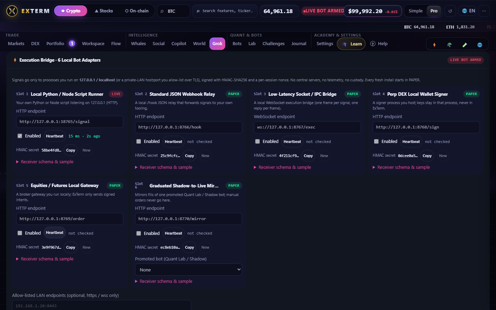

### 🔌 Six original local adapter slots (Grok tab → Execution Bridge; status card in Settings)
| Slot | Adapter | Default endpoint |
|---|---|---|
| 1 | Local Python / Node Script Runner | `http://127.0.0.1:8765/signal` |
| 2 | Standard JSON Webhook Relay | `http://127.0.0.1:8766/hook` |
| 3 | Low-Latency Socket / IPC Bridge | `ws://127.0.0.1:8767/exec` |
| 4 | Perp DEX Local Wallet Signer | `http://127.0.0.1:8768/sign` |
| 5 | Equities / Futures Local Gateway | `http://127.0.0.1:8769/order` |
| 6 | Graduated Shadow-to-Live Mirror | `http://127.0.0.1:8770/mirror` |

- **PAPER / SIMULATION on every fresh install.** In paper mode fills are logged as simulated routes and nothing leaves the page.
- **Loopback only.** Endpoints must be `127.0.0.1` / `localhost`, or a private-LAN `host:port` you allow-list over
  `https://` / `wss://`. Public hosts, look-alike names, metadata IPs, credentials in URLs and redirects are refused.
- **Signed.** Every envelope is HMAC-SHA256 signed with a per-slot secret and carries a per-session nonce, a timestamp
  and a rising sequence number, so your receiver can drop forged, stale or replayed messages. Each slot shows its
  receiver schema and a 15-line Python sample receiver.
- **Heartbeat latency** in ms per slot. Slot 6 mirrors the fills of one promoted Quant Lab / Shadow bot; manual orders never go there.

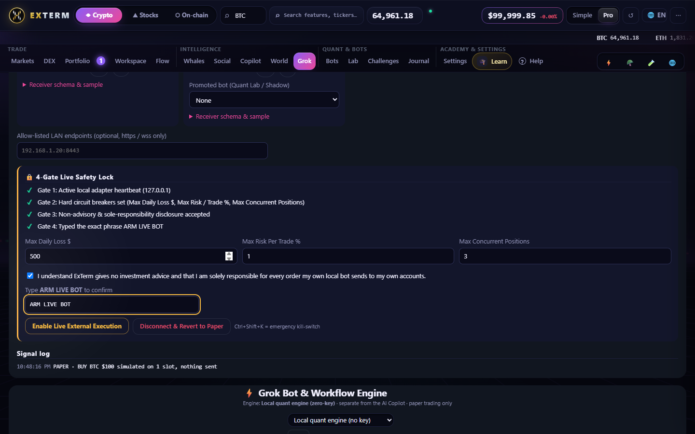

### 🔒 4-Gate Live Safety Lock
**Enable Live External Execution** stays disabled until all four pass:
1. An enabled adapter answers a signed `127.0.0.1` heartbeat handshake (fresh within 2 minutes).
2. Hard circuit breakers are set: **Max Daily Loss $**, **Max Risk Per Trade %**, **Max Concurrent Positions**.
3. The non-advisory, sole-responsibility disclosure box is checked.
4. The exact phrase **`ARM LIVE BOT`** is typed.

While live, the configuration is frozen and every opening order is checked against the breakers (closing orders
always pass). Three missed heartbeats on an armed slot revert everything to PAPER automatically.

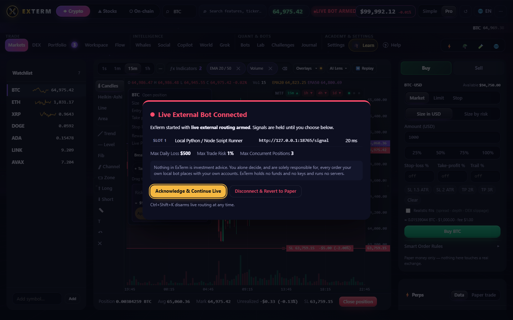

### 🚨 Boot briefing, LIVE pill and kill-switch
- Booting or reloading with a live bot armed opens the **Live External Bot Connected** briefing: slot, endpoint,
  live heartbeat, caps and the non-advisory reminder. Signals are held until you pick **Acknowledge & Continue Live**
  or **Disconnect & Revert to Paper**.
- A pulsing **LIVE BOT ARMED** pill sits in the top bar while live.
- **`Ctrl+Shift+K`** is the emergency kill-switch: it disarms instantly, reverts all six slots to PAPER and sends each
  receiver a signed `disarm` message.

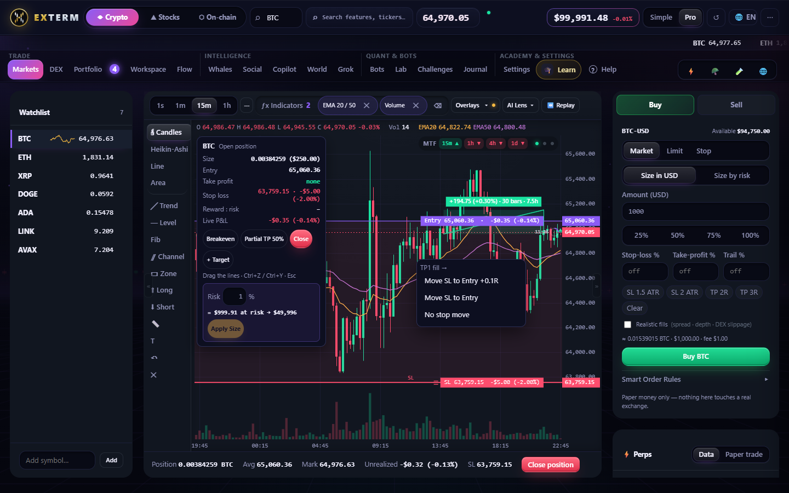

### ✅ Verified
`python build.py` and `python build.py --harden` (strict `default-src 'none'` CSP with SHA-256 script and style
hashes, no inline handlers). `test/v160.test.js` (42 checks) and `test/v160_e2e.js` (36 checks at 1440×900 in English
and Arabic, against a real HMAC-verifying receiver on 127.0.0.1) plus the full v15.x regression suite.

---

## 🧭 What's new in v15.7
Sub-second true-form candles and pure-canvas 3D analytics. New 1s / 5s / 10s timeframes are seeded from an in-memory 1-second tick ring, so they switch in under 10 ms, and every fast candle keeps a real body (at least 4px wide and 2.5px tall). Five rotatable 3D views: Order-Book Liquidity Terrain, Options IV & Gamma Surface, Correlation & Regime Orbit, Quant Lab Profit Mountain and Whale & Liquidation Cluster Orbit. Hidden views draw zero frames.

---

## 🪶 What's new in v15.6

**Visual minimalism and a smoother engine.** Every v15.5 capability is still here. The screens read in half a second,
and the chart keeps its frame rate while the heavy maths runs elsewhere.

### 🌑 Calmer surfaces
- **Tonal elevation instead of outlines**: the canvas is `#0B0E14`, panels `#111620` and active cards `#181F2E`. Most 1px
  borders are gone and the market columns get 20px of breathing room.
- **Three text sizes**: 18px bold for primary figures, 13px for active labels, 11px for muted metadata.
- **One-word tabs**: Markets · Flow · DEX · Whales · Lab · Grok · Journal · Learn (full names stay in the tooltip; translated
  languages keep their own labels).
- **4px scrollbars** that stay invisible until you hover the scroll area.
- **Chart-first dimming**: with the cursor over the price chart, the watchlist and order ticket fade to 78%. Hover a panel
  and it snaps back to 100%.

### 📉 Lighter rows
- **44px sparklines** replace the % column in the Watchlist and sit beside the price in the DEX table.
- **Shorthand figures** (`$1.43M`, `+48.2%`, `$0.0₅48`) with the exact value in the hover tooltip.
- **One badge per row**: the leaderboard shows the Alpha pill, the DEX table the safety grade. Everything else is in the inspector.
- **Hover-only row actions**: row buttons appear when you hover or keyboard-focus that row.

### 🔎 One inspector rail

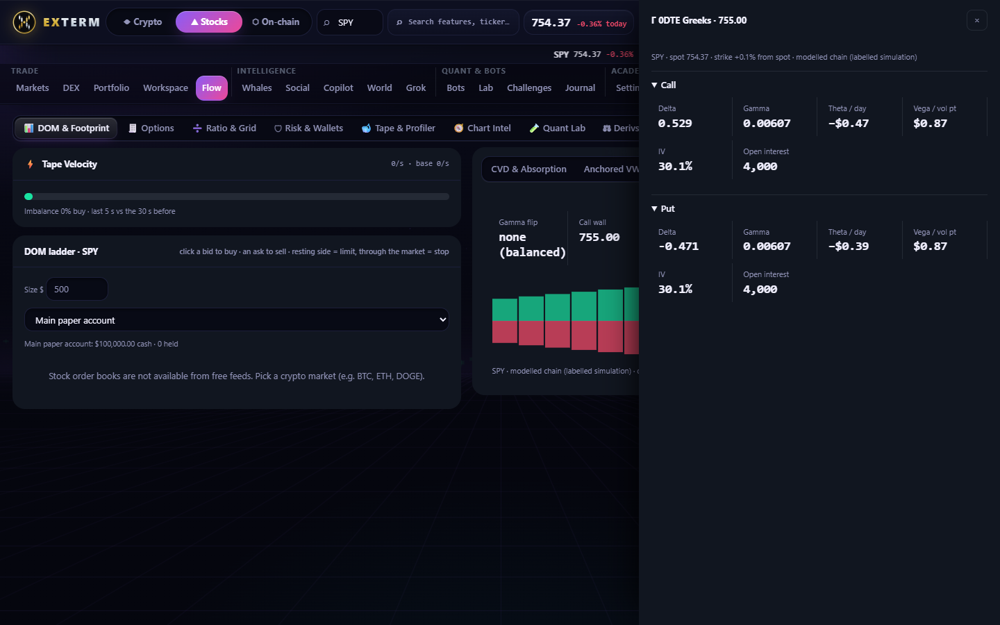

DEX Token Audit, Whale Trader Detail and 0DTE strike Greeks share one right-hand rail with the same width, surface and
motion. Opening one replaces the other. Leaderboard rows open the trader on a whole-row click, and the leaderboard
reflows beside the rail instead of hiding under it. Clicking a 0DTE gamma bar shows Delta, Gamma, Theta/day, Vega, IV
and open interest for that strike's call and put.

### ⚡ Zero-lag engine
- **O(1) latest-bar indicators**: on every tick only the forming bar is recomputed for EMA 20/50, SMA 200, Bollinger,
  RSI and MACD. The result matches a full recompute to double precision, which is unit- and browser-tested. Heavier
  overlays and picker indicators refresh on each new bar and at most 4× a second while a bar forms.
- **Off-thread quant runs**: Pro Desk walk-forward and the 1,000-run Monte Carlo run in the backtest Web Worker. The
  fallback without workers yields between chunks and gives the same numbers.
- **Windowed trade logs**: every backtest trade is scrollable (not just the newest 300), with only the visible rows in
  the page.

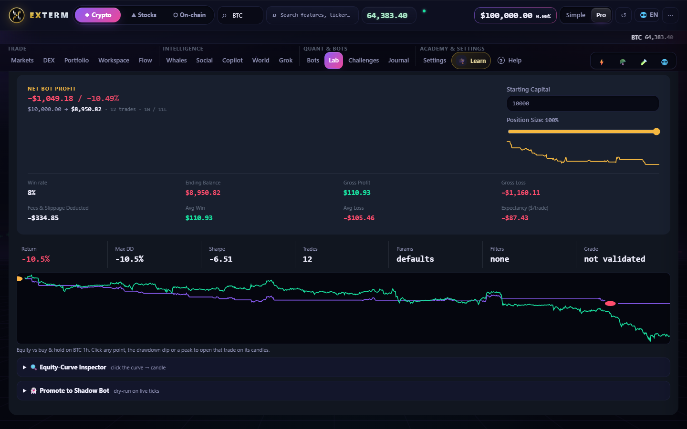

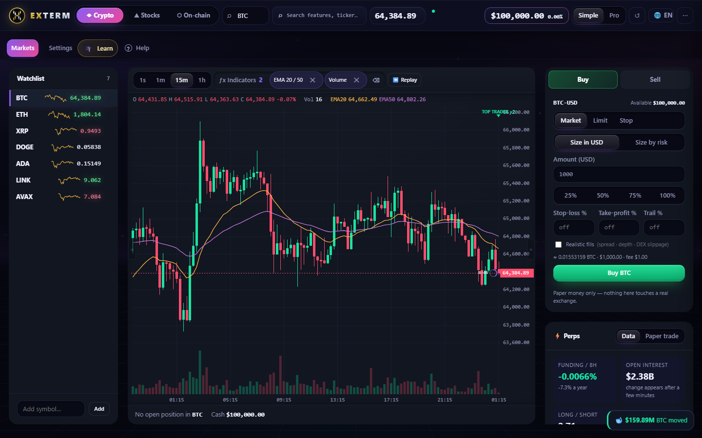

---

## ✨ What's new in v15.5

**Zero-clutter visual polish, a dollar profit card on every backtest, and a smoother workspace.** Every v15.4
capability is still here; the screens are just calmer. Each view now has one gold primary action, single hairlines
replace nested boxes, figures use tabular digits, and loud banners became quiet status dots.

### 💵 Bot Net Profit hero card

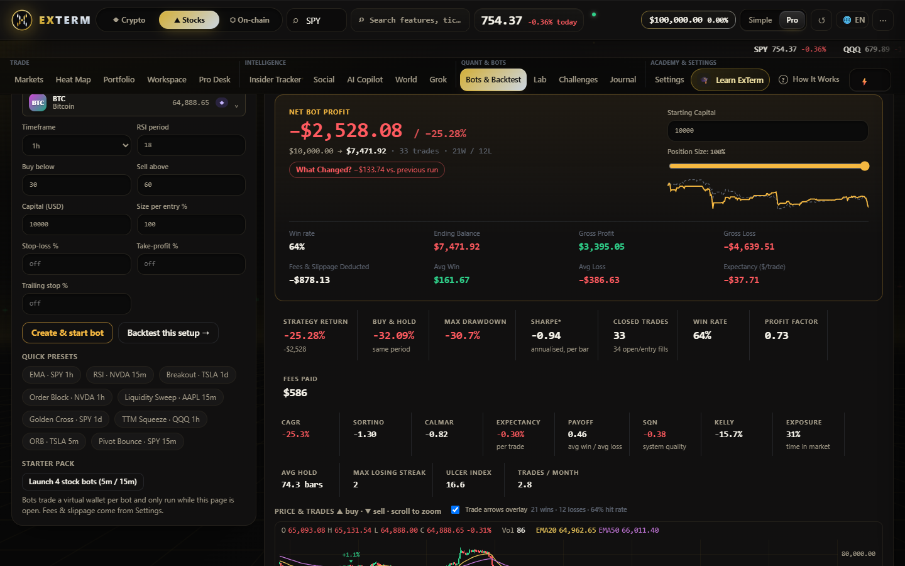

- **Net Bot Profit (+$X,XXX.XX / +XX.XX%)** above every backtest: Starting Capital → Ending Balance, Win rate, Gross Profit,
  Gross Loss, Fees & Slippage Deducted, Avg Win, Avg Loss and Expectancy ($/trade).
- Change **Starting Capital** and every dollar figure and the equity curve rescale instantly. Drag **Position Size** and the run is re-simulated.
- **What Changed?** Re-run with new parameters or Kill-Switch filters to see the previous run as a ghost curve plus the exact dollar delta (`+$1,240.00 vs. previous run`).

### 🧪 Quant Lab as a 4-step wizard

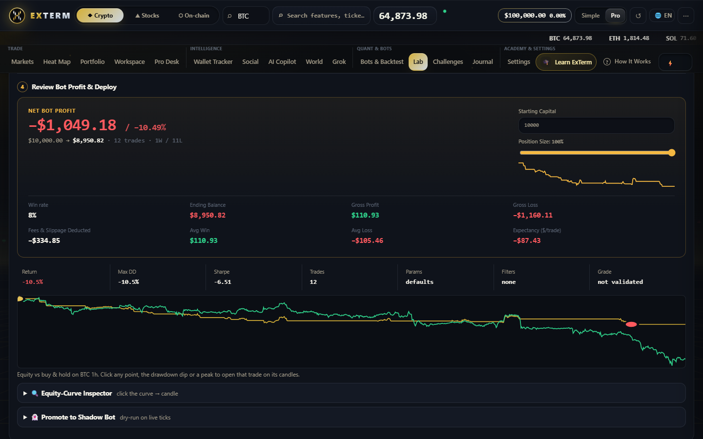

**1. Pick or Build Strategy → 2. Run Stress Tests → 3. Set Capital & Risk Sizing → 4. Review Bot Profit & Deploy.**
Every institutional tool sits inside its step, and empty states offer a 1-click **Run Starter Backtest**.

### 🔎 Ctrl+K: search everything

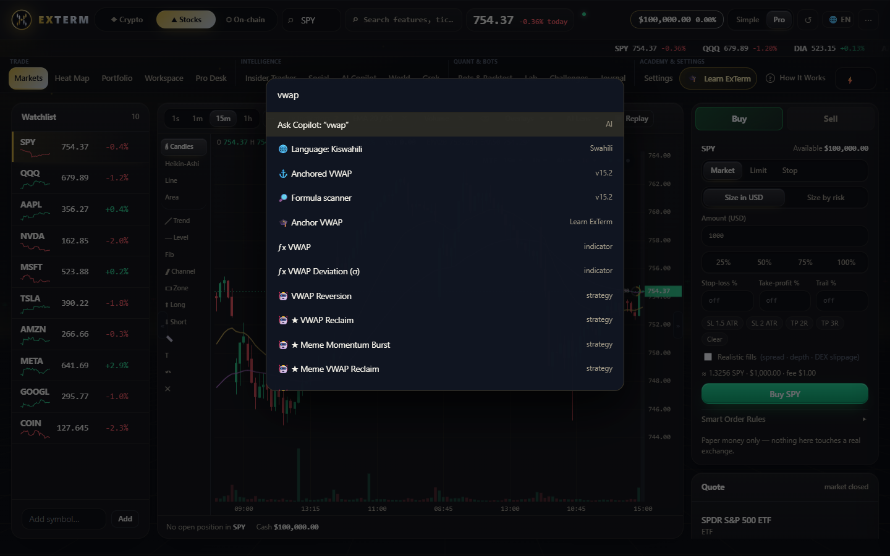

The header pill **Search features, tickers, tools… Ctrl+K** covers every tab, overlay, Quant Lab section, leaderboard,
Learn ExTerm lesson, all 137 indicators, every strategy and the workspace commands. Search is typo-tolerant and matches
labels in your language. Picking a result jumps straight there with a gold spotlight pulse.

### 🧘 Simple | Pro, Zen Chart Focus and Reset Clean View

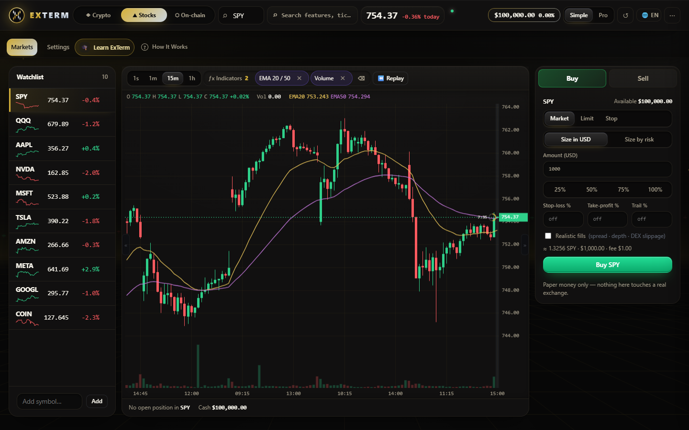

- **Simple** shows only the chart, watchlist, a clean order ticket, Learn ExTerm and Settings. **Pro** (default) shows every tab
  under four captions: Trade · Intelligence · Quant & Bots · Academy & Settings.
- **Zen Chart Focus**: press `F` or use the slim `«` / `»` chevrons to run the chart edge to edge.
- **↺ Reset Clean View** closes every drawer, switches overlays off and restores the default layout.
- The chart toolbar is one row (`1s | 1m | 15m | 1h`, Indicators, **Overlays ▾**, **AI Lens ▾**, Replay). Overlays highlight
  what fits the asset class (0DTE Gamma & Gap-Fill on stocks, Safety Score & Holder X-Ray on-chain), and you can star up to
  **4 favourites** into a quick bar beside the order ticket.
- The order ticket keeps the essentials; Auto-Breakeven step-ladders and the Webhook Bridge live in one collapsed
  **Smart Order Rules ▸** accordion, with an inline **Risk: 1.0%** slider.

### 🏆 Leaderboards: 4 columns + Trader Detail & Mirror drawer

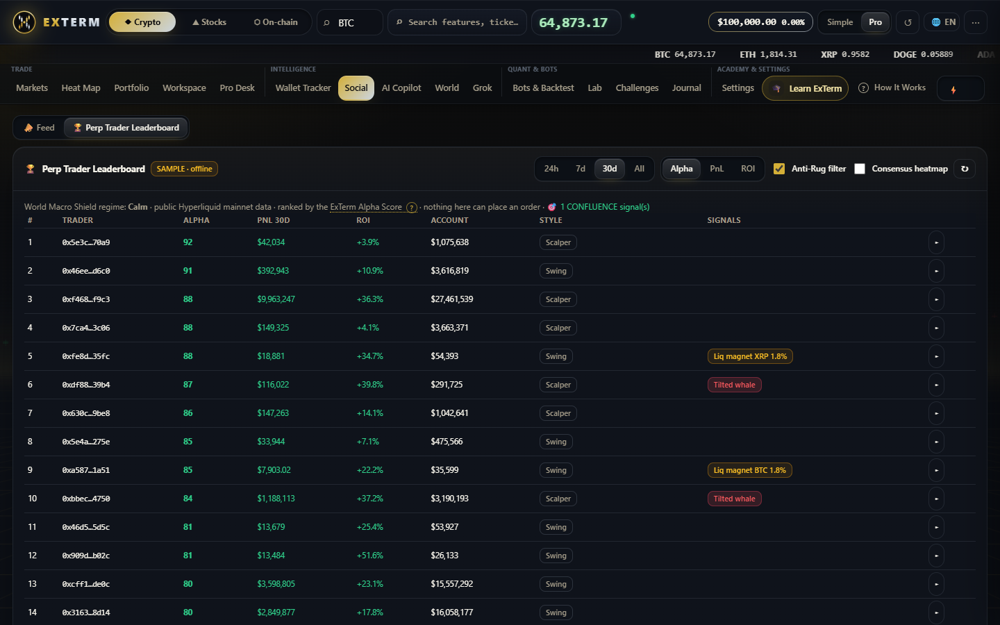

One filter strip (timeframe, Alpha / PnL / ROI, **Style**, Anti-Rug, chart heatmap) and 4 columns. Opening a trader slides out
**Trader Detail & Mirror** with Plot on Chart, Backtest Style, Shadow Mirror, Track Wallet, Exit Alerts and Liquidation Magnet.

### 🌊 Order Flow: a clean 2-column split

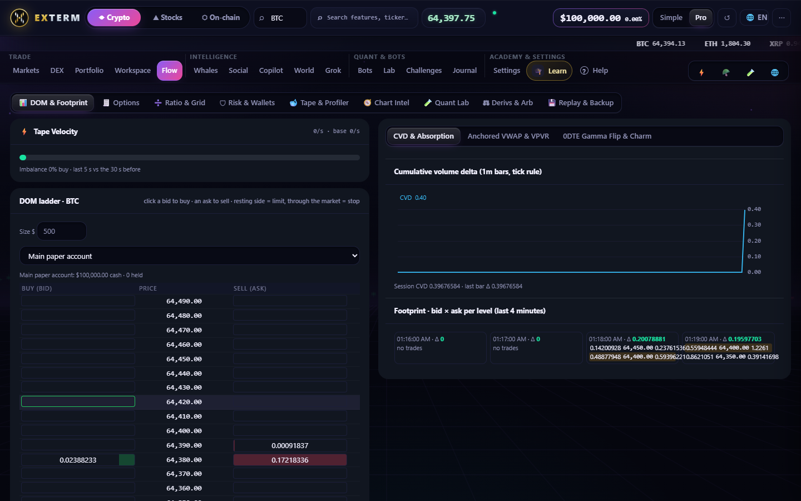

The DOM ladder and a compact **Tape Velocity** bar sit on the left. On the right, one tabbed card switches between
**CVD & Absorption**, **Anchored VWAP & VPVR** and **0DTE Gamma Flip & Charm**.

### ⬡ DEX table + Inspect Token drawer


Four columns (Token / Pair, Price & 24h %, Safety Score, Signal). Click a row to slide out **Inspect Token** with the
Dev-Wallet Cluster X-Ray, LP Lock Details, Gap-Fill Scanner and Lead-Lag Divergences.

### ⚡ Grok intelligence rail and 4-tab Settings

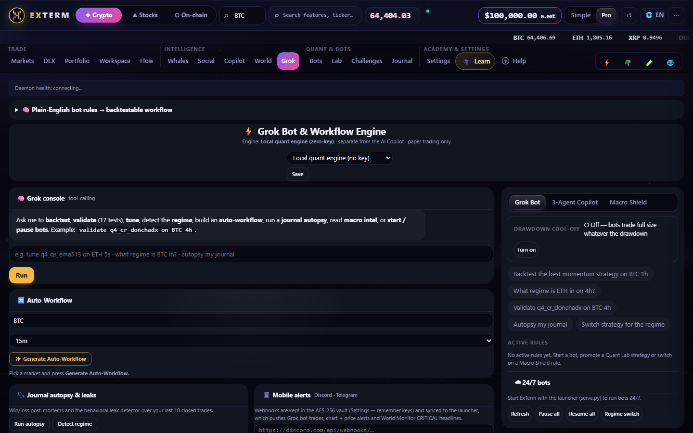

A 3-tab rail (**Grok Bot**, **3-Agent Copilot**, **Macro Shield**) with one-click starter prompts, active-rule cards and a
plain-English Drawdown Cool-Off pill. Settings is organised into **General & Language**, **Chart & Hotkeys**,
**Execution & Webhooks** and **Security & Vault**.

---

## 🎓 What's new in v15.4

**Unified Master Edition: learn every tool, follow on-chain smart money, and 15 workstation upgrades, with the trading
canvas still clean.** The top bar gains one gold **🎓 Learn ExTerm** button beside Settings and the header one 🧰 icon.
Leaderboards live inside tabs you already have, and every new overlay is opt-in.

### 🎓 Learn ExTerm: Interactive Academy

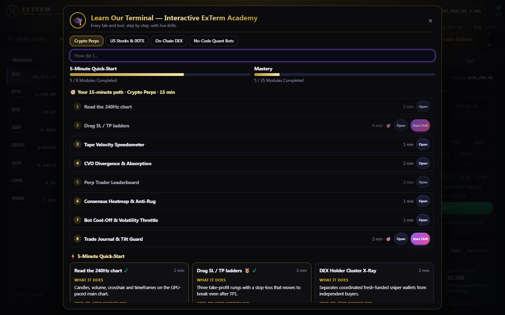

- **Learn Our Terminal — Interactive ExTerm Academy**: every tab and subcategory as lesson cards with *What It Does*,
  *Step-by-Step Workflow*, *Pro Tip / Risk Guardrail*, *Keyboard Shortcut* and **Try It Live →**. That button jumps to the exact tab,
  Lab section or drawer and pulses a gold spotlight ring around the control.
- **"How do I…" fuzzy search** across 35 lessons, shortcuts and categories, plus a **5-Minute Quick-Start** track and a
  live **X / Y Modules Completed** mastery bar.
- **Learning paths**: pick *Crypto Perps*, *US Stocks & 0DTE*, *On-Chain DEX* or *No-Code Quant Bots* to get an ordered
  playlist of lessons and drills that fits in 15 minutes.
- **Start Drill sandboxes**: a seeded volatile breakout or thin DEX pool loads on the chart (tagged *SANDBOX · simulated*).
  The badge is awarded only when ExTerm sees you do the action: drag a TP rung, anchor VWAP, size by % risk or open the
  holder X-ray.
- **Explain This Metric**: a subtle **?** (or Alt+hover) on 0DTE Gamma Flip, Fragility Break-Point, ExTerm Alpha Score,
  CVD Divergence and Dealer Charm / Vanna, with *Open Full Lesson →*.
- Moving the academy into **Settings → Documentation & Academy** later means changing one constant: `LEARN_MOUNT_TARGET`.


### 🏆 On-Chain Perp & Smart-Money Leaderboards


- **Crypto → Social → Perp Trader Leaderboard** (`Feed | Perp Leaderboard`): public, permissionless Hyperliquid mainnet
  traders ranked over **24h / 7d / 30d / All** by PnL, ROI or the **ExTerm Alpha Score (0–100)**. The score blends
  risk-adjusted ROI 35%, drawdown control 25%, consistency 25% and liquid, non-churning size 15%.
- Expand any trader to see live positions (asset, side, leverage, entry, unrealized PnL, liquidation), then:
  **📐 Chart Setup** plots their entry and liquidation on your chart, **🪞 Shadow Mirror** logs their position changes as
  Grok dry-run fills (no custody, no balance touched), **+ Track Wallet**, and **🧪 Backtest Style** turns their cadence,
  hold time and favoured pair into a Quant Lab run through the 17-test gate.
- **On-chain → Wallet Tracker → Smart-Money Wallet Leaderboard**: public top-25 plus your saved wallets, ranked by win
  rate, realised PnL and Alpha Score. A **CONFLUENCE** alert and **TOP TRADER** chart pin fire when 2+ top-25 wallets
  enter the same pair and side within 15 minutes.
- Signals: **-40% Size Trimmed / SL Tightened / Full Exit** badges, **Tilted Whale** (size doubles after a losing
  streak), **Liquidation Magnet** (within 2.5% of liquidation, drawn on the chart as a sweep target), style tags
  (Scalper, Swing, Mean-Reversion, News Sniper) next to the World Macro Shield regime, a **Consensus Heatmap** strip on
  the price axis (top-25 long entries, take-profit clusters, liquidation walls), and an **Anti-Rug / Copy-Trap filter**
  that screens out dust win-rate padding, circular wash volume and bundled fills.
- The launcher proxies just two allow-listed hosts (`stats-data.hyperliquid.xyz`, `api.hyperliquid.xyz/info` with three
  read-only request types). It caches answers for 30 seconds in RAM, schema-validates them and backs off when the
  upstream rate-limits. `--offline` serves a clearly flagged seeded sample.

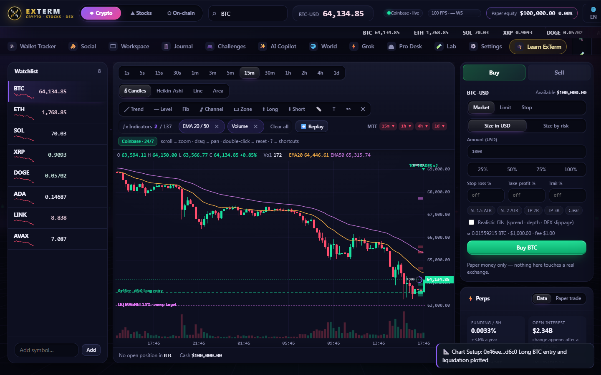

### 🧰 15 workstation upgrades (one Pro Tools drawer, all opt-in)

| Area | Upgrades |
|---|---|
| 📈 Charts & execution | **Ghost candles** (15m / 1h / 4h shells behind 1s / 1m bars) · **Auto-Breakeven & trailing step-ladder** (right-click a TP rung: *Move SL to Entry +0.1R on TP1 fill*, *Trail SL to TP1*; enforced on the paper position and sent to an allow-listed webhook bridge) · **Opening range (5 / 15 / 30m) + Asia / London / NY kill-zones** |
| 🌊 Order flow & 0DTE | **Tape velocity & aggressive-sweep speedometer** · **Dealer charm & vanna drift curve** with pin vs squeeze windows · **Absorption footprints** on candle bodies |
| 🔭 Scanners & DEX | **Gap-fill probability** (gap %, RVOL, 90-day fill rate) · **Holder cluster X-ray** (coordinated fresh-funded clusters vs independent buyers) · **Correlation & lead-lag decoupling** (NVDA / SMH, ETH / BTC, …) |
| ⚡ Grok & 3-Agent Copilot | **Alt+click "Why did price just move?"** forensics sent to the Copilot · **Plain-English pattern hunter** (*bullish FVG above VWAP with RVOL > 2.5x*) · **Bot cool-off & volatility throttle** (½ size after 2 losses, pause when ATR > 2.5× its 20-day mean) |
| 🌍 Macro & journal | **FOMC / CPI / NFP reaction overlay** (first-5-minute spike, fakeout, 60-minute follow-through) · **Tilt & revenge-trade guard** · **Replay My Worst Loss** in bar replay, 30 s before entry |


### 🛡 Platform
- The CSP now pins the stylesheet as well: `style-src-elem` allows only the inline `<style>` block's SHA-256 hash
  (alongside the existing script hash under `default-src 'none'`).
- 28 new UI strings in all 32 named languages, with RTL mirroring for Arabic, Hebrew, Persian and Urdu.
- New tests: `test/v154.test.js` (74 unit checks), `test/v154_server_test.py` (34 launcher checks) and
  `test/v154_e2e.js` (60 headless-Chrome checks, English and Arabic RTL).

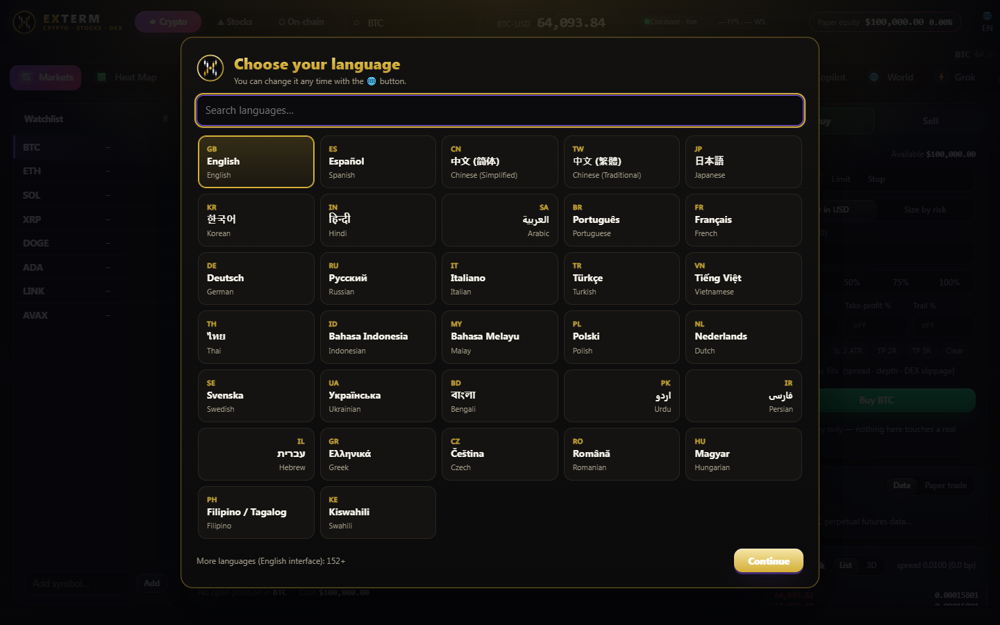

---

## 🧬 What's new in v15.3

**Institutional Quant Lab, still uncluttered.** The Lab tab gains one 🧬 **Quant Lab Pro** pill. Inside, you pick a
strategy (every built-in strategy plus your No-Code specs), run one backtest and get a clickable equity curve. The eight
institutional tools sit in collapsed accordions and render only when you open them. Heavy runs go to a background Web
Worker, so the UI stays responsive.

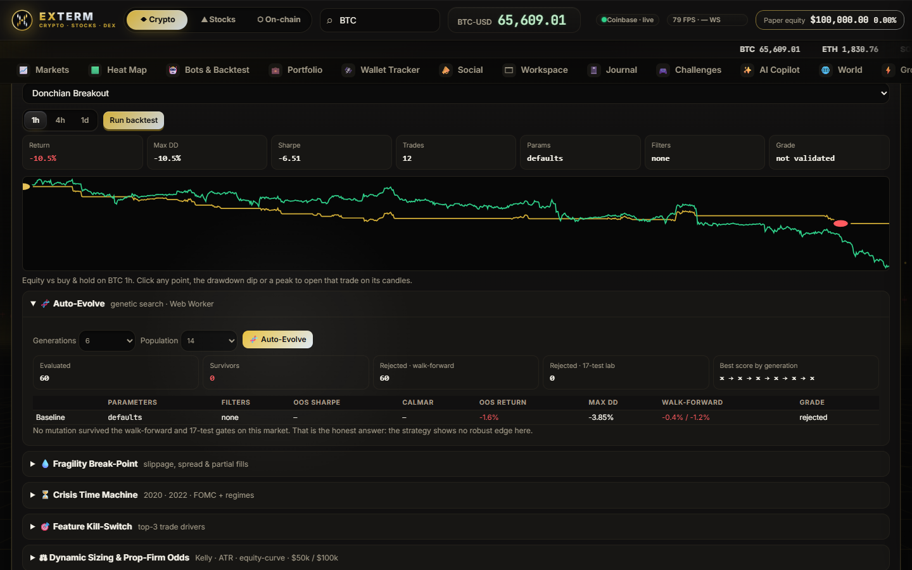

| Tool | What it answers |
|---|---|
| 🧬 **Auto-Evolve** | Mutates parameters and robustness filters (trend EMA, ATR stop, cooldown, time stop) over several generations. Survivors are ranked by **out-of-sample Sharpe + Calmar**; any mutation that loses money in a walk-forward window or grades D/F in the **17-test Validation Lab** is rejected. |
| 💧 **Fragility Break-Point** | Widens spreads with volatility, adds square-root market impact for your size and partial fills above a participation cap, then shows the **exact friction multiplier where the strategy flips unprofitable**. |
| ⏳ **Crisis Time Machine** | One-click replays of the **2020 Liquidity Flush**, **2022 Crypto Deleveraging** and **FOMC rate-shock** windows, plus PnL and drawdown attribution across **Bull Trend, Bear Trend, Low-Vol Chop and High-Vol Panic**. |
| 🎯 **Feature Kill-Switch** | Scores every entry on session, RVOL, ATR percentile, RSI and VWAP distance, surfaces the **top 3 drivers** of wins vs losses, and lets you toggle filters that recalculate the equity curve instantly. |
| ⚖ **Dynamic Sizing & Prop-Firm Odds** | Replays the same trades under **Fixed Fractional, Half-Kelly, ATR volatility-targeting and Equity-Curve Trading**, with Monte Carlo odds of passing a **$50k / $100k** evaluation without breaching daily or trailing drawdown limits. |
| 🌀 **Synthetic Paths** | Hundreds to thousands of block-bootstrap paths that keep fat tails and volatility clustering but reshuffle history (optional adversarial noise), so an edge has to come from market behaviour, not memorised dates. |
| 🔍 **Equity-Curve Inspector** | Click any point, drawdown dip or peak on the curve to open that trade on its candles with entry / exit pins, **MFE / MAE** and the indicator snapshot, then jump to the same candle on the chart. |
| 👻 **Promote to Shadow Bot** | Validated strategies (grade A–C) are packaged with their strategy ID, evolved parameters and risk limits and tick in the **Grok dry-run shadow mode** on live bars. Zero capital at risk. |


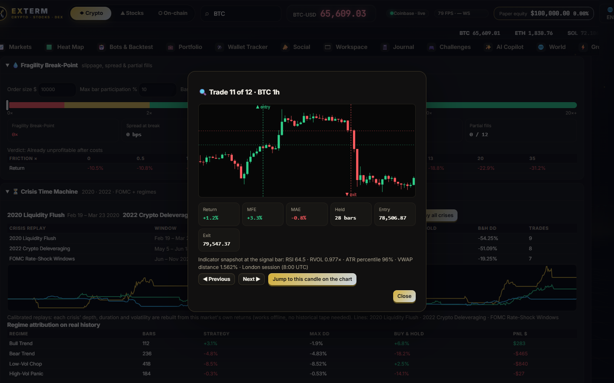

---

## 🌐 What's new in v15.2

**Powerful without overwhelm.** v15.2 adds 44 workstation upgrades, but the default screen only gains three things: a
🌐 language pill, a 🧭 **Workstation** button and a subtle bar-timer ring next to the price. Everything else sits in
collapsed drawer sections (rendered only when you open them), `Ctrl+K` commands, opt-in chart overlays and **H** for
HUD clean mode.

### 🌍 First-launch language gate

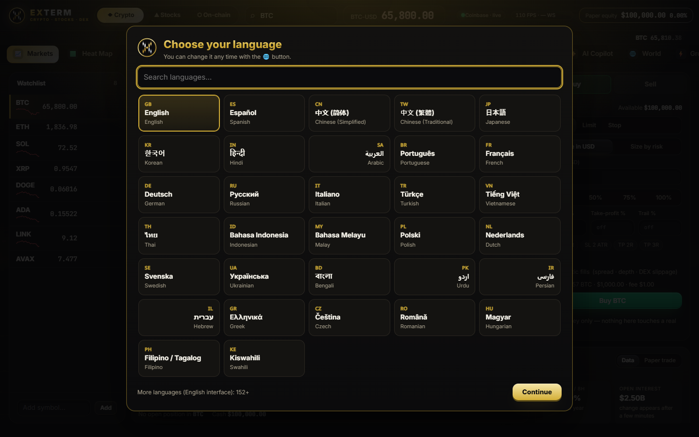

The very first screen asks for your language, pre-selected from your browser. 32 languages are fully translated in the
app shell (English, Español, 中文 简体 / 繁體, 日本語, 한국어, हिन्दी, العربية, Português, Français, Deutsch, Русский, Italiano,
Türkçe, Tiếng Việt, ไทย, Bahasa Indonesia / Melayu, Polski, Nederlands, Svenska, Українська, বাংলা, اردو, فارسی, עברית,
Ελληνικά, Čeština, Română, Magyar, Filipino, Kiswahili), and every other ISO-639-1 locale is selectable with English
text. Arabic, Hebrew, Persian and Urdu switch the layout to right-to-left. The 🌐 pill switches live, any time.

### 📈 Charting & execution
Bar-timer countdown ring · crosshair / timeframe / symbol **sync groups A / B / C** across pop-out windows · draggable
**TP1 / TP2 / TP3 ladder** with % splits and automatic break-even after TP1 · optional FVG, order-block, engulfing and
liquidity-sweep labels (off by default) · **Ctrl-hold magnet** snap to candle OHLC · future FOMC / CPI / earnings markers
(add your own) · **H** HUD clean mode with a Candle X watermark · higher-timeframe picture-in-picture on 1s / 5s / 15s.

### 🌊 Order flow & options


Iceberg / spoof wall detector on crypto order books · CVD divergence markers · **click-to-anchor VWAP** with ±1σ / ±2σ
bands (or anchor to a ⚠️ MACRO pin) · Asia / London / NY session volume profiles · zero-gamma, gamma-flip and call / put
walls on the stock chart · unusual options filter with watchlist badge routing · **multi-leg payoff builder** (verticals,
straddles, strangles, iron condors) with live breakevens and a theta-decay curve.

### 🔀 Markets, scanners & DEX


Market-swap memory (timeframe, indicators and risk % per market) · **formula scanner** (`RVOL > 3 AND Price > VWAP`,
parsed, never `eval`'d) saved as tabs · DEX safety strip (mint, freeze, top-10 holders, LP lock) · smart-money leaderboard
and **multi-wallet confluence alerts** · bubble heat map in **$ net-inflow** mode (1m / 5m / 15m) · watchlist sparklines,
relative strength vs BTC / SPY and hover trade-plan notes · DEX priority-fee & slippage presets (Normal / Fast / Turbo).

### 🧪 Quant lab


No-code **IF / AND / OR composer** → Pine Script v5 or JSON · multi-asset portfolio backtester (combined Sharpe +
correlation) · parameter sensitivity heatmap (robust plateau vs overfit spike) · one-click **Fix Weak Gate** for the
17-test Validation Lab · Apex / Topstep / FTMO / custom prop rulebooks · replay speed keys **1 / 2 / 5 / 0** and a
**Blind Drill** that hides ticker and dates · journal MFE / MAE with auto-tags · 4-way strategy battle.

### ⚡ Grok, copilot & World

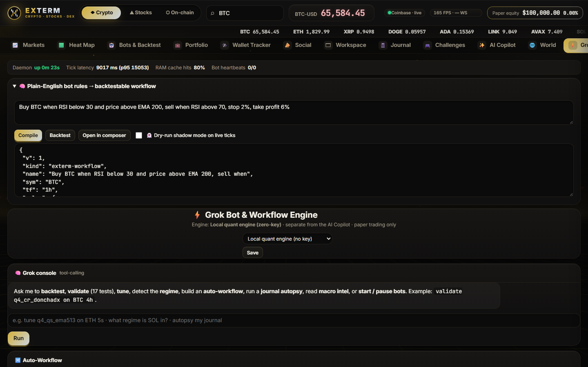


Plain-English **rule compiler** → backtestable workflow JSON · ask the 3-agent Copilot about a selected candle range ·
optional **devil's advocate** A–F grade before a bracket order · World headlines tagged by impact (OIL/XLE, NVDA/SMH,
BTC/DXY…) with a 1-click trade-impact switch · Discord / Telegram **alert cards with a chart snapshot** · daemon health
strip (uptime, tick latency, RAM cache hit rate, bot heartbeats) · pre-market levels brief and end-of-day recap ·
**dry-run shadow mode** that logs hypothetical fills on live ticks without touching balances.

### 🛡 Platform
ECDSA-signed **`.exterm` share codes** (tampering breaks the signature; the signer fingerprint is shown) · 1s-bar
memory governor · theme token editor on top of Obsidian & Gold · `Ctrl+K` calculator (`10000 * 0.015 / 12.5`), language
and theme switching · local data cache manager · **Settings → Verify build integrity** (on-disk hashes vs
`SHA256SUMS.txt`, live `default-src 'none'` CSP check, inline-handler scan).

---

## ✨ What's in v15.1

### 🔁 1-Click Universal Market Swap

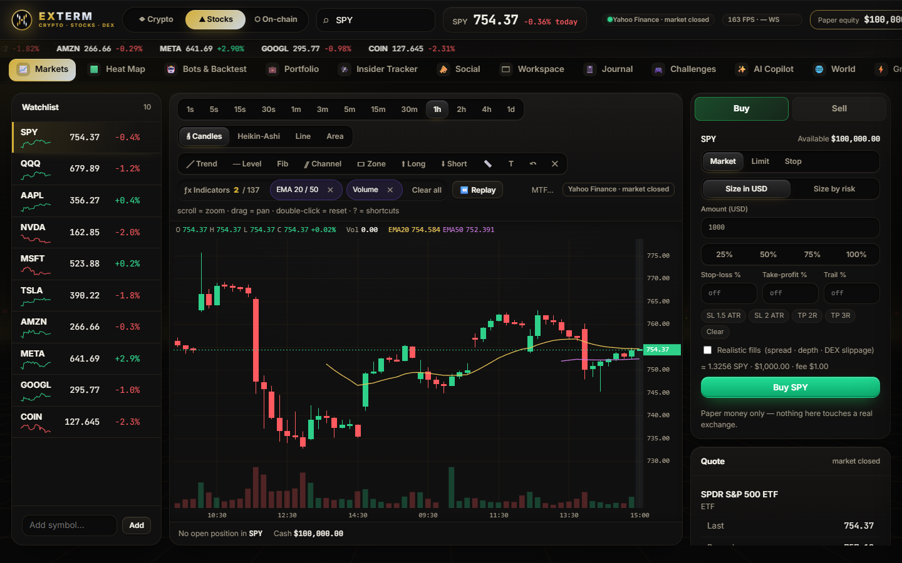

Switch between **Crypto** (Coinbase, Kraken, Binance spot plus a paper **perps** ticket), **Stocks** (US equities and ETFs
via Yahoo Finance) and **On-chain** (DEX pools via DexScreener and GeckoTerminal) from the header. Each mode keeps
its own watchlist, selected symbol and timeframe, and the same chart, ticket, indicators and tools follow you across.

Charts draw at your display's refresh rate (an adaptive governor targets 60 – 240 Hz and steps down when frames get expensive).
One-click **workspace presets** (Alt+1…4): Scalper, On-chain Trench, Quant Lab, Macro War Room.

### 🕯 Live 1s & 5s candles

1s / 5s / 15s / 30s charts are built from every trade print (Binance `@trade`, Coinbase `matches`, Kraken `trade`), so highs
and lows move inside each second. Stock and DEX bars use each launcher quote (about one every 2 s); ExTerm never invents wicks
that didn't trade. Sub-minute charts scale to the candles on screen, with a 3 px minimum body.

### 🎯 Chart + click-to-trade, draggable SL/TP, % risk sizing

- A **+** handle on the price axis places a paper limit / stop order, alert or level at that exact price.
- Buys open a **draft bracket** with draggable **Entry**, **Stop-Loss** and **Take-Profit** lines, shaded risk/reward zones,
  live $ P&L and R-multiple. Breakeven, Partial TP 50 %, and Ctrl+Z / Ctrl+Y for line moves.
- A **% risk pill** sizes the position from your account risk and stop distance, with **Apply Size**.
- Optional **realistic fills**: spread, order-book depth impact, DEX AMM fee and slippage.

### 📊 137 indicators · 128 backtestable strategies

- **137 indicators** in a searchable picker, with editable settings and multi-timeframe trend chips.
- **128 backtestable strategies** (SMC, trend, momentum, mean reversion, breakout, volume, price action, on-chain, plus
  crypto / stocks / DEX / quant packs) and a no-code strategy builder.
- **17-test Validation Lab** that grades a strategy A–F, **walk-forward optimisation** (in-sample parameter pick,
  out-of-sample score), **Monte Carlo** (1,000 seeded trade reshuffles), risk of ruin and a candle data-quality grade.
- **Pine Script v5**: export strategies to Pine Script v5, and a **v5-compatible importer** that translates a safe subset
  (`ta.*` indicators, crossovers, comparisons, `strategy.entry` / `close`, % stops) into ExTerm's no-code format. It never
  executes the script and lists anything it skipped.

### ⚡ Dedicated Grok & World tabs

- **World** — the World Monitor feed: global breaking and macro headlines with severity counts and filters, and the live
  **Macro Shield** level. Every headline is escaped; links are limited to http(s).
- **Grok** — a tool-calling bot & workflow console: backtest, run the Validation Lab, tune, detect the regime, build an
  auto-workflow, run a journal autopsy, read macro intel and start / pause launcher bots. Works with a local quant engine
  (no key) or your own xAI key.

### 🏆 Prop-firm & Black Swan challenges

- **Prop-Firm $50K / $100K Evaluation**: +8 % target, 4 % daily loss limit, 8 % max trailing drawdown.
- **Black Swan Survival**: 2020 COVID, 2022 FTX and 2008 financial-crisis scenarios.
- Also: 10-min scalping sprint, zero-indicator price action, and a strategy → prop-challenge runner for any backtestable strategy.
- Every round earns a discipline grade (A+ to F) and an optional 1080×1080 flex card.

### 🔐 AES-256 local vault + SHA-256 CSP

- API keys and alert channels live in a **local vault**: AES-256-GCM with a PBKDF2-SHA256 key (600,000 rounds) from your passphrase.
  By default keys last for the browser session only and are never written to disk in plain text.
- **Encrypted `.exterm` backups** of everything ExTerm stores (AES-256-GCM, PBKDF2-SHA256, 600,000 rounds).
- See [Security](#-security) for the CSP and launcher hardening.

---

## 🛡 Security

- **Strict Content-Security-Policy**: `default-src 'none'`, and the single bundled script is pinned by its **SHA-256 hash**
  at build time. Injected `<script>`, inline event handlers (`onclick`, `onchange`, …) and `eval` are blocked; the source
  contains no inline handlers.
- **Escaped rendering**: all remote data (token names, news, social posts, wallet data) is HTML-escaped; links must be
  absolute `http(s)`.
- **Launcher lock-down** (`serve.py`, `serve.ps1`): listens on localhost only, fresh session token every launch, exact
  Origin + port check, Host allow-list against DNS rebinding, rate limiting, proxy allow-list with redirect re-validation
  and response size caps.
- Audit report: [`SECURITY-AUDIT.md`](SECURITY-AUDIT.md) · reporting policy: [`SECURITY.md`](SECURITY.md).

---

## ✅ How to verify official builds

Official releases are published only at **<https://github.com/uexxx/ExTerm/releases>**. Each ships a `SHA256SUMS.txt`
with relative file names. Inside the app, **Settings → Verify build integrity** does the same check through the launcher
and also confirms the live `default-src 'none'` Content-Security-Policy. That in-app check catches accidental corruption;
to rule out tampering, compare `SHA256SUMS.txt` itself with the one on the release page.

```bash
# macOS / Linux, from the ExTerm folder
sha256sum -c SHA256SUMS.txt          # macOS: shasum -a 256 -c SHA256SUMS.txt
```

```powershell
# Windows PowerShell, from the ExTerm folder
Get-Content SHA256SUMS.txt | ForEach-Object {
  $h, $f = $_ -split '\s+', 2
  if ((Get-FileHash $f -Algorithm SHA256).Hash -eq $h) { "OK   $f" } else { "FAIL $f" }
}
```

`python3 serve.py --doctor` also checks the app file against its checksum. `dist/SHA256SUMS.txt` covers every file in `dist/`.

---

## 🔧 Build

```bash
python3 build.py             # dist/exterm.html (readable) + exterm.html
python3 build.py --harden    # dist/exterm.min.html (minified with esbuild)
```

`build.py` inlines `src/*.js` and `src/style.css` into one file and stamps the CSP with the bundle's SHA-256 hash.
Tests: `powershell -ExecutionPolicy Bypass -File test\run-all.ps1` (unit, launcher and browser end-to-end suites;
needs Node 18+, Playwright and Chrome).

---

## 📜 License

Use of ExTerm is governed by the terms in **[`LICENSE`](LICENSE)**. The ExTerm name and logo are **not** licensed; see
the brand policy below.

Copyright (c) 2026 ExTerm Labs (@exterm.labs) · https://github.com/uexxx/ExTerm

## 🏷 Brand & Logo Policy

The names **ExTerm**, **ExTerm.labs**, **@exterm.labs** and the **Candle X** candlestick-and-diamond mark are reserved and
are not covered by the license. Modified versions must use their own name and logo and credit <https://github.com/uexxx/ExTerm>.
Details: **[`BRAND_GUIDELINES.md`](BRAND_GUIDELINES.md)**.

## 📣 Follow ExTerm Labs

- **Instagram:** [@exterm.labs](https://www.instagram.com/exterm.labs): demos, new features and release drops
- **X (Twitter):** [@ExTermLabs](https://x.com/ExTermLabs): updates and changelogs

Official accounts are only the ones above and <https://github.com/uexxx/ExTerm>.

---

<sub>ExTerm is an educational paper-trading tool, not financial advice. Market data comes from third-party public APIs and may
be delayed or wrong. Past backtest results do not predict future returns.</sub>
