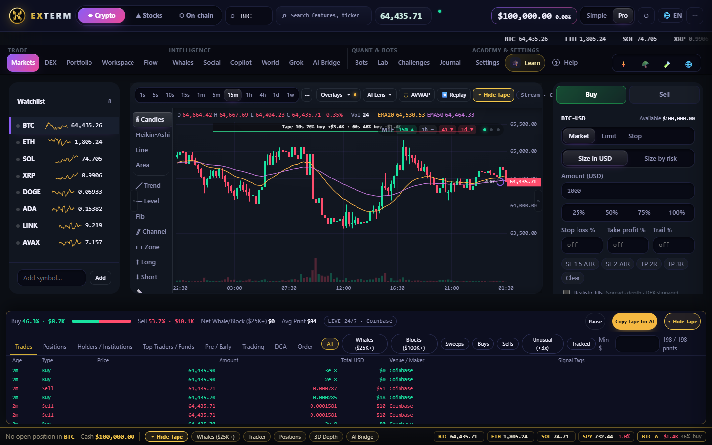
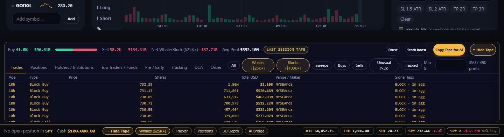
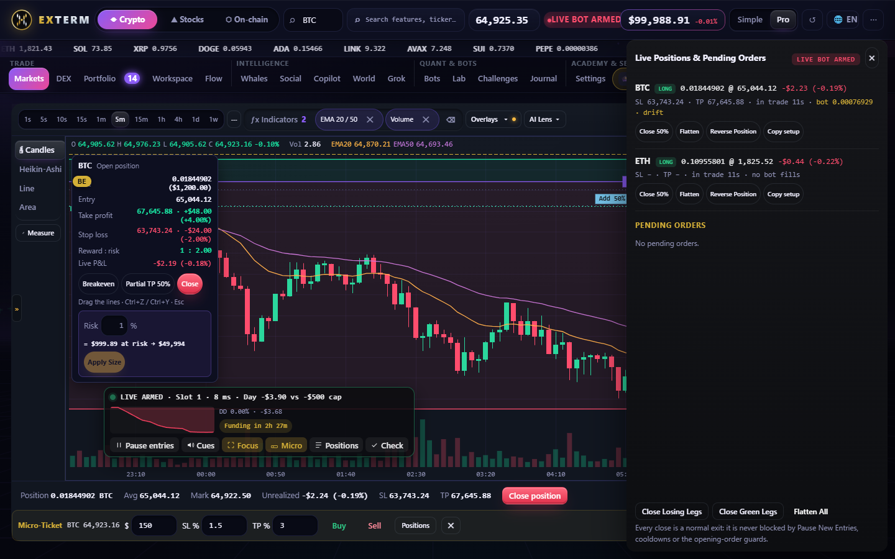
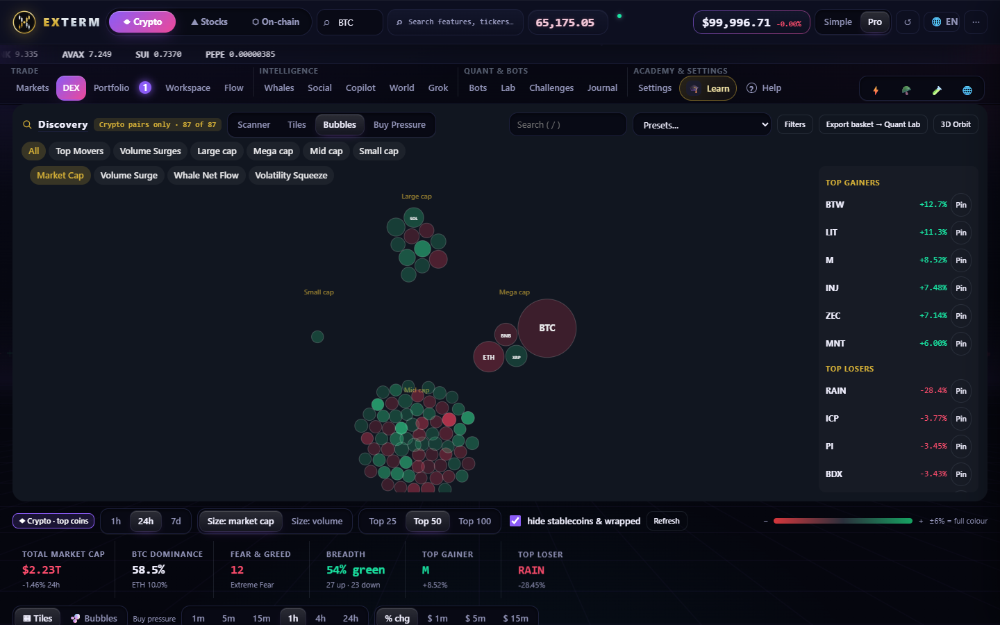
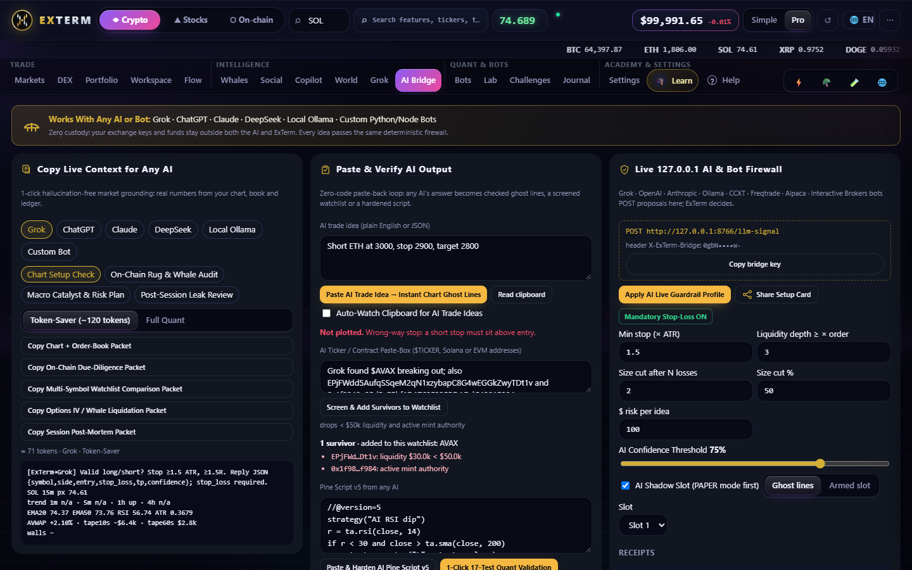
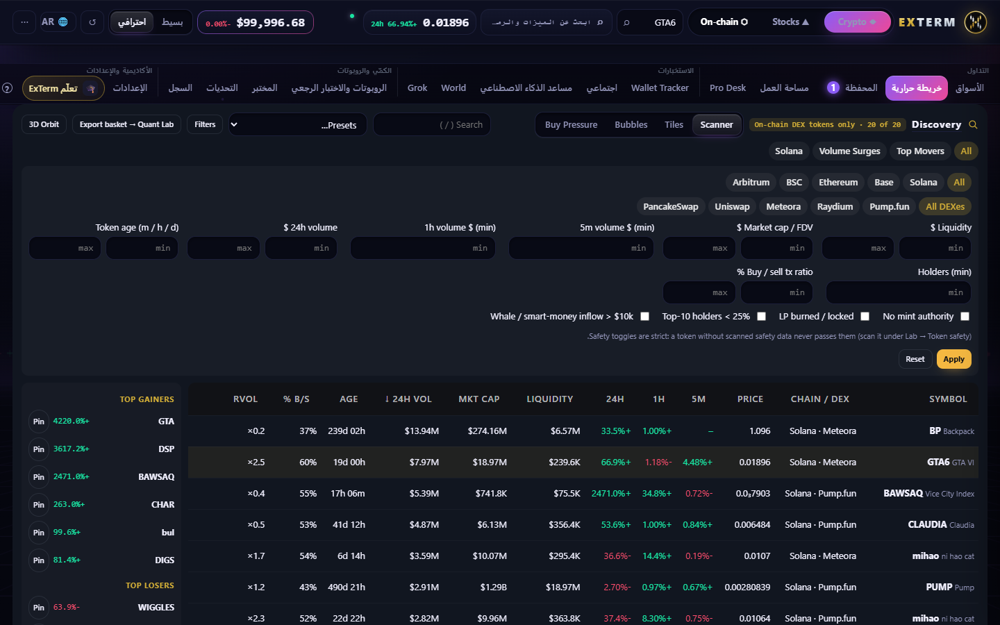
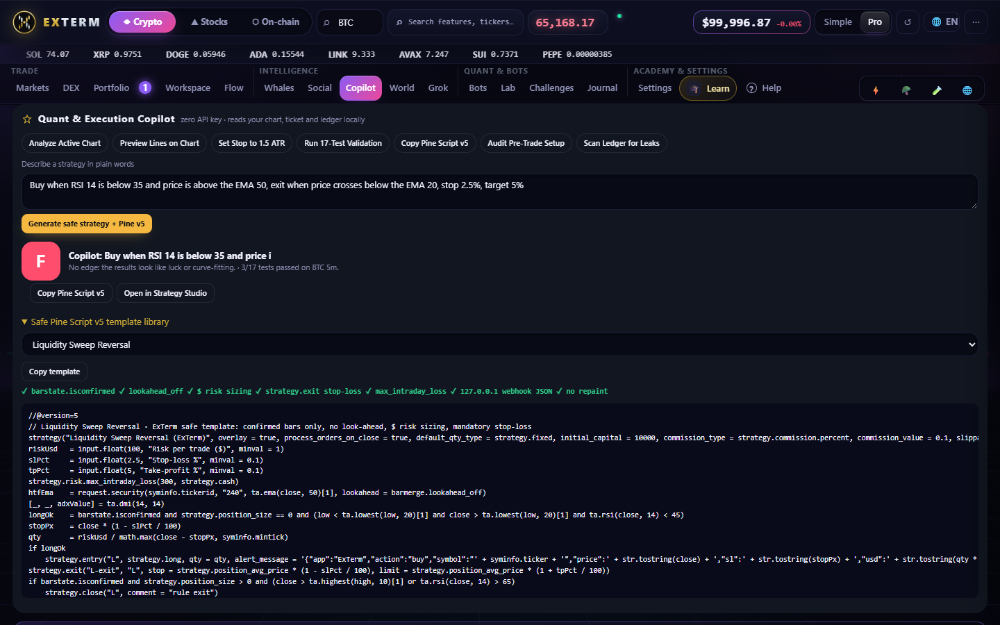
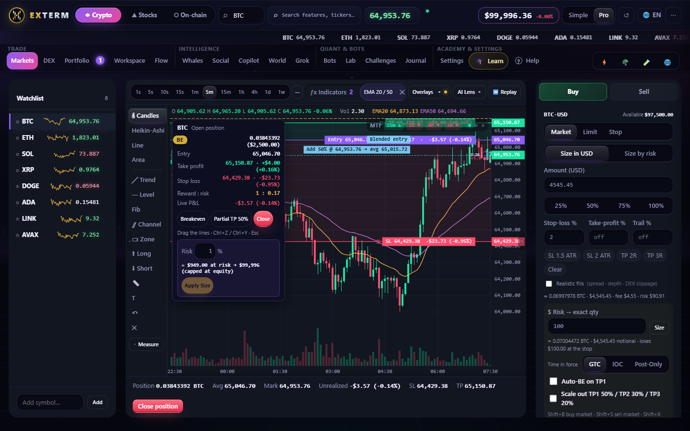

<div align="center">


<p>
  <a href="https://github.com/uexxx/ExTerm/releases/tag/v16.6"></a>
  <a href="LICENSE"></a>
  
  
</p>

### The $0, local-first trading terminal for **Stocks · Crypto · On-Chain / DEX**, built to work with any AI or bot.

**Your money never leaves your broker, exchange or wallet.** ExTerm holds no funds and no keys. It paper-trades by default;
live signals go only to a bot **you** run on `127.0.0.1`, HMAC-signed, checked by ten risk engines and locked behind four gates.

**[Launch](#launch)** · **[Subsystems](#subsystems)** · **[Cost](#cost)** · **[Firewall](#firewall)** · **[Gallery](#gallery)** · **[History](#history)** · **[License](#license)**

</div>


```text
╔════════════════════════════════════════════════════════════════════════════════╗
║ EXTERM TERMINAL // SYSTEM MANIFEST                              v16.6 HARDENED ║
╠════════════════════════════════════════════════════════════════════════════════╣
║  BUILD              single-file exterm.html · stdlib launcher · no install     ║
║  MARKETS            US Stocks · Crypto spot & perps · On-Chain / DEX · Options ║
║  RENDER             adaptive 60-240 Hz canvas · Float64Array tape rings        ║
║  TAPE               Time & Sales open by default · 8 sub-tabs · whale / block  ║
║  DOCK               position · cash · 6 quick chips · BTC ETH SOL SPY pills    ║
║  RESEARCH           137 indicators · 134 strategies · 17-test validation lab   ║
║  AI                 Grok · ChatGPT · Claude · DeepSeek · Ollama · own bots     ║
╟────────────────────────────────────────────────────────────────────────────────╢
║  CUSTODY            ZERO · paper by default · signals to YOUR 127.0.0.1 bot    ║
║  RISK               10 deterministic fail-safes · 4-gate live lock             ║
║  SECURITY           SHA-256 pinned CSP · AES-256-GCM vault · HMAC envelopes    ║
║  PRICE              $0 forever · AGPL-3.0 · no account, no subscription        ║
╚════════════════════════════════════════════════════════════════════════════════╝
```

<a id="launch"></a>


ExTerm is one HTML file plus a small standard-library launcher. No account, no install, no build step, no subscription.

| Platform | Do this |
|---|---|
| **Windows** | Unzip to e.g. `C:\ExTerm`, double-click **`start-exterm.bat`** (falls back to the built-in PowerShell server `serve.ps1` if Python isn't installed) |
| **macOS** | Double-click **`start-exterm.command`** |
| **Linux / any** | `./start-exterm.sh` or `python3 serve.py` → <http://localhost:8765> |

```bash
cd ~/ExTerm && python3 serve.py          # opens Chrome on http://localhost:8765
python3 serve.py 9000 --no-browser       # other port, no browser
python3 serve.py --doctor --offline      # health check + checksum self-test
```

> Opening `exterm.html` directly also works for crypto, but browsers block some stock and on-chain sources. The launcher
> proxies only an allow-list of public market-data hosts, on `localhost`, behind a fresh per-launch token.



<a id="subsystems"></a>


### `01` · 240 Hz multi-asset charting & direct order execution

One chart engine for **Crypto, US Stocks, On-chain DEX tokens, Options and Futures**, drawn at your display's refresh rate
(an adaptive governor targets 60–240 Hz and steps down when frames get expensive).

- **Every timeframe:** `1s · 5s · 10s · 15s · 1m · 5m · 15m · 30m · 1h · 4h · 1d · 1w · 1M`, true-form gapless candles;
  quiet sub-minute bars are re-anchored instead of drawing flat `Vol 0.00` filler.
- **Resilient data:** Kraken ↔ Coinbase ↔ Binance public-trade failover after a 1.5 s stall; a 500 ms DEX swap tape de-duplicated by transaction hash.
- **137 indicators**, multi-timeframe trend pills, drawing tools, **⚓ AVWAP**, and a 10 s / 60 s tape-delta + book micro-imbalance strip.
- **Trade on the chart:** click Entry / Stop / Target, drag any line, **R:R and $ P&L badges**, the **BE** pill, Auto-BE on TP1, TP1–TP3 scale-out.
- **Order ticket:** market / limit / stop, **$ Risk → exact quantity**, GTC / IOC / Post-Only, Chase Limit. Hotkeys `Shift+B` · `Shift+S` · `Shift+X` · `F`.

### `02` · Live Transactions tape (Time & Sales) + bottom telemetry dock



- **Open by default** on Markets for every market: a 230 px drawer under the chart (the chart shrinks; nothing is covered),
  collapsible with the gold **`▾ Hide Tape`** / **`▴ Live Tape`** toggle.
- **2,000-print typed-array ring per symbol:** `Float64Array` ts / price / size / USD + `Uint32Array` side bitmask / venue.
  22 pooled DOM rows, re-filtered at most 30×/s, measured under 0.2 ms per frame. Stocks, Crypto and On-Chain stay strictly isolated.
- **8 sub-tabs:** Trades · Positions · Holders / Institutions · Top Traders / Funds · Pre / Early · Tracking · DCA · Orders.
  **Chips:** All · Whales ($25K+) · Blocks ($100K+) · Sweeps · Buys · Sells · Unusual (>3x) · Tracked, plus min USD.
- Hover **auto-pauses** (gold Paused pill), click a print to pin a gold marker on the chart, **Copy Tape for AI** feeds the AI Bridge.
- **Zero setup:** public Coinbase / Kraken / Binance trades 24/7, DEX pool swaps with maker wallets, stock last-sale volume
  through the launcher (**LAST SESSION TAPE** when closed). Optional Stock boost with your own Finnhub / Alpaca key (tab-only).
- **Telemetry dock** (every tab): position & **Cash** · quick-dock chips **Live Tape · Whales ($25K+) · Tracker · Positions ·
  3D Depth · AI Bridge** · live **BTC · ETH · SOL · SPY** pills and the active symbol's tape flow delta.

### `03` · Closed-loop zero-custody live execution cockpit (`127.0.0.1`)



- **HMAC-SHA256 signed** intents (fresh session key, 3 s expiry, idempotency key, rising sequence) to a bot you run; ACK + fill reconciliation.
- **Six local adapter slots**, ~40-line starter bridges for Interactive Brokers, Alpaca, CCXT and Freqtrade, a Multi-Slot Strategy Router.
- Floating Live HUD, Focus Chart, Micro-Ticket, Position & Pending Orders Drawer, Two-Key Arming (`Shift + Alt + A`), 3-Second Readiness Self-Check.

### `04` · DEX Discovery & pure-canvas 3D market structure



- **One dataset, four views:** Scanner · Tiles · Bubbles · Buy Pressure, strictly isolated per market pill.
- GMGN-style on-chain filter drawer (chains, DEXes, liquidity / FDV / volume / age / holder ranges, safety toggles, presets).
- **Five 3D engines, zero 3D libraries:** Order-Book Liquidity Terrain, Options IV & Gamma Surface, Profit Mountain, Correlation Orbit, Whale Liquidation Orbit.

### `05` · 17-test Quant Lab & Strategy Studio Pro


- Drag-and-drop node builder → **17-test Validation** (walk-forward, 1,000-run Monte Carlo, risk of ruin, slippage fragility, data quality).
- Depth-aware square-root slippage, ≤ 10-symbol portfolio with correlation matrix, Flash Crash / FOMC / Thin Weekend stress.
- **134 backtestable strategies**, replay on chart, export to Pine Script v5 or a standalone Python / Node bot.

### `06` · Universal AI Bridge, Copilot & AI-vetted copy-trading



- Works with **Grok · ChatGPT · Claude · DeepSeek · Local Ollama · custom Python / Node bots**: copy a grounded packet out, paste ideas back in.
- Pasted ideas become **ghost lines** with R:R and $ badges only after a directional-stop + ATR check. Nothing is ever placed for you.
- `POST http://127.0.0.1:8765/llm-signal`: loopback-only, schema + stop checked, signed receipt, guardrail profile, PAPER shadow slot.
- **Quant & Execution Copilot** (no API key, no network): chart reader, plain English → safe strategy + Pine v5, stop auditor, ledger leak detector.
- **Copy engine:** multi-wallet consensus, anti-front-run drift shield, your own $ risk and ATR stop, per-leader daily loss cap.

### `07` · On-chain intelligence, 32 languages + RTL & Learn ExTerm



- Launch Radar, token safety scanner, wallet tracker, smart-money & perp leaderboards with Trader Detail & Mirror.
- **32 languages** with full right-to-left mirroring, chosen at first launch.
- **Learn ExTerm:** 35 interactive lessons, sandbox drills, a 5-minute quick-start and "How do I…" search.

<a id="cost"></a>


| Capability | Typical legacy stack (USD / yr) | ExTerm |
|---|---:|:---:|
| Pro charting, multi-timeframe alerts, drawing tools | $240 – $720 | **$0** |
| Real-time US stock & options data | $360 – $2,400 | **$0** ¹ |
| Order-flow / Time & Sales tape, whale & block filters | $480 – $3,600 | **$0** |
| On-chain whale, wallet & DEX analytics | $360 – $4,800 | **$0** |
| Backtesting & quant validation suite | $240 – $2,520 | **$0** |
| AI trading co-pilot subscriptions | $240 – $2,400 | **$0** ² |
| Copy-trading / signal services | $120 – $9,600 | **$0** |
| **Total** | **$2,040 – $26,040+ / yr** | **$0 forever** |

<sub>Indicative ranges for comparable retail plans; your own costs vary. ¹ Free sources are 1-minute last-sale volume for
stocks; the optional Stock boost uses your own Finnhub / Alpaca key. ² Bring any AI you already use, or 100% offline Ollama.</sub>

<a id="firewall"></a>


```text
╔════════════════════════════════════════════════════════════════════════════════╗
║ 127.0.0.1 DETERMINISTIC RISK FIREWALL                            10 FAIL-SAFES ║
╠════════════════════════════════════════════════════════════════════════════════╣
║  [01] REQUIRE STOP-LOSS      every live opening order needs a valid stop       ║
║  [02] SIGNAL FIREWALL        schema · fat-finger notional cap · SSRF guard     ║
║  [03] SIGNED ENVELOPES       HMAC-SHA256 · 3 s TTL · nonce · rising seq        ║
║  [04] DEPTH & STALE QUOTE    book depth >= 3x order · stale quotes freeze      ║
║  [05] RATE & EXPOSURE CAPS   max trades / hour · global 6-slot exposure        ║
║  [06] DRAWDOWN THROTTLE      50% size after 2 losses · cooldown timer          ║
║  [07] CORRELATION GUARD      refuses r > 0.85 · thin-hours spread halving      ║
║  [08] EXECUTION SHIELD       spread ceiling · ticker allowlist · pause         ║
║  [09] MAX DAILY LOSS         breach -> CANCEL_ALL_AND_FLATTEN -> PAPER         ║
║  [10] DEAD-MAN / KILL        missed heartbeat · idle · Ctrl+Shift+K flat       ║
╟────────────────────────────────────────────────────────────────────────────────╢
║  CSP    default-src 'none' · bundle pinned by SHA-256 hash at build            ║
║  DOM    no inline handlers · no eval · every dynamic string escaped            ║
║  NET    localhost only · per-launch token · Origin + Host checks               ║
║  DATA   AES-256-GCM key vault (PBKDF2-SHA256) · encrypted backups              ║
╚════════════════════════════════════════════════════════════════════════════════╝
```

Every AI idea, bot signal and manual live order passes the **same** deterministic checks. Audit report:
[`SECURITY-AUDIT.md`](SECURITY-AUDIT.md) · reporting policy: [`SECURITY.md`](SECURITY.md).

**Verify official builds.** Releases are published only at <https://github.com/uexxx/ExTerm/releases>, each with a
`SHA256SUMS.txt`. In the app, **Settings → Verify build integrity** runs the same check and confirms the live CSP.

```bash
sha256sum -c SHA256SUMS.txt          # macOS: shasum -a 256 -c SHA256SUMS.txt
```

```powershell
Get-Content SHA256SUMS.txt | ForEach-Object {
  $h, $f = $_ -split '\s+', 2
  if ((Get-FileHash $f -Algorithm SHA256).Hash -eq $h) { "OK   $f" } else { "FAIL $f" }
}
```

<a id="gallery"></a>


<table>
<tr>
<td width="50%"></td>
<td width="50%"></td>
</tr>
<tr>
<td></td>
<td></td>
</tr>
</table>

<a id="history"></a>


| Version | Date | Highlights |
|---|---|---|
| **v16.6** | Nov 2026 | 240 Hz typed-array **Live Transactions tape** for Stocks · Crypto · On-Chain / DEX (8 sub-tabs, whale / block / sweep chips), now **open by default**, plus the Obsidian & Gold **bottom telemetry dock** |
| v16.5 | Nov 2026 | **AI Bridge** for any model or bot, `127.0.0.1/llm-signal` firewall, AI-vetted copy engine, privacy-masked share card |
| v16.4 | Nov 2026 | DEX Discovery (4 views), AVWAP, multi-exchange failover, Quant & Execution Copilot, Strategy Studio Pro |
| v16.3 | Nov 2026 | Closed-Loop Live Cockpit: HUD, Micro-Ticket, ACK + fill sync, Two-Key Arming, Require Stop-Loss ON by default |
| v16.2 | Nov 2026 | Universal timeframes, true-form sub-minute candles, Max Daily Loss auto-flatten, launch safety briefing |
| v16.1 | Nov 2026 | Chart click-to-trade, context menu, Measure dragger, 8 live-bot fail-safe engines |
| v16.0 | Nov 2026 | Six local adapter slots, 4-Gate Live Safety Lock, kill-switch |
| v15.7 | Nov 2026 | 1s ring, rollups and candle geometry hardening |
| v15.6 | Nov 2026 | Calmer surfaces, lighter rows, one inspector rail, zero-lag engine |
| v15.5 | Nov 2026 | Bot Net Profit card, Quant Lab wizard, `Ctrl+K` search, Simple / Pro modes |
| v15.4 | Nov 2026 | Learn ExTerm academy, on-chain perp & smart-money leaderboards, Pro Tools drawer |
| v15.3 – v15.1 | Nov 2026 | Language gate (32 + RTL), 1-click market swap, live 1s / 5s candles, 137 indicators, AES-256 vault + SHA-256 CSP |

Full notes for every release: [`CHANGELOG.md`](CHANGELOG.md).


## Build

```bash
python3 build.py             # dist/exterm.html (readable) + exterm.html
python3 build.py --harden    # dist/exterm.min.html (minified with esbuild)
```

`build.py` inlines `src/*.js` and `src/style.css` into one file and stamps the CSP with the bundle's SHA-256 hash.
Tests: `powershell -ExecutionPolicy Bypass -File test\run-all.ps1` (unit, launcher and browser end-to-end suites; needs Node 18+, Playwright and Chrome).

## Brand & Logo Policy

The names **ExTerm**, **ExTerm.labs**, **@exterm.labs** and the **Candle X** candlestick-and-diamond mark are reserved and
are not covered by the license. Modified versions must use their own name and logo and credit <https://github.com/uexxx/ExTerm>.
Details: **[`BRAND_GUIDELINES.md`](BRAND_GUIDELINES.md)**.

## Follow ExTerm Labs

<a href="https://www.instagram.com/exterm.labs"></a>
<a href="https://x.com/ExTermLabs"></a>

Official accounts are only the ones above and <https://github.com/uexxx/ExTerm>.

<a id="license"></a>

## AGPL-3.0 License & Disclaimer

ExTerm is free software under the **GNU Affero General Public License v3.0**: see **[`LICENSE`](LICENSE)**. It costs $0,
forever. The ExTerm name and logo are not licensed (see the brand policy above).

Copyright (c) 2026 ExTerm Labs (@exterm.labs) · https://github.com/uexxx/ExTerm

> **Disclaimer.** ExTerm is an educational paper-trading and research tool, **not financial advice**. Market data comes from
> third-party public APIs and may be delayed or wrong. Backtest results do not predict future returns. Live trading through
> your own bot is at your own risk; ExTerm never holds your funds or keys.
